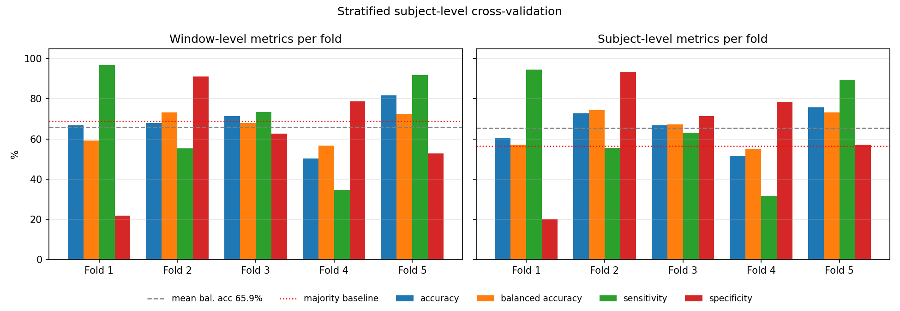

# 🧠 Parkinson's Disease Detection via Gait Analysis (MSCAF-Gait)

> **Deep learning model for non-invasive Parkinson's Disease detection using multi-sensor foot pressure signals**

---

## 📌 Overview

This project implements **MSCAF-Gait** — a Multi-Scale Convolutional Attention Fusion architecture for detecting and staging Parkinson's Disease (PD) using Ground Reaction Force (GRF) signals from foot pressure sensors.

Traditional PD diagnosis relies on subjective clinical assessments. This model explores an **objective, data-driven alternative** by analyzing gait dynamics — a clinically validated PD biomarker — using deep learning.

The codebase supports three tasks, **one per run**, selected with `CONFIG['task']`:

| `CONFIG['task']` | Output |
|---|---|
| `pd_detection` | PD vs. Healthy Control (binary) |
| `severity` | UPDRS score (regression) |
| `hy_stage` | Hoehn & Yahr stage (5-class) |

The results below are for `pd_detection`, the only task with real ground-truth labels independent of the demographics file.

> ⚠️ **Note on UPDRS & H&Y labels:** The PhysioNet dataset includes real UPDRS and H&Y scores in a `demographics.xls` file, which `main.py` parses automatically when present. If it is absent, synthetic labels are generated as a fallback — in that case, severity regression and H&Y staging results are **not clinically valid**. Binary PD classification always uses real ground-truth labels from the file-naming convention.

---

## 🧩 Model Architecture

```
Raw GRF Signal (16 sensors × 1000 timesteps)
        │
        ▼
┌──────────────────────────────┐
│ Shallow Feature Extraction   │  4 × [Conv1d + BN + ReLU + Dropout],
│ (1D CNN)                     │  3 × MaxPool  →  (B, 128, T/8)
└──────────────┬───────────────┘
               │
               ▼
┌──────────────────────────────┐
│ Multi-Scale Convolution      │  4 parallel Conv1d branches,
│ kernels 1 / 3 / 5 / 7        │  64 channels each, concatenated
└──────────────┬───────────────┘  →  (B, 256, T/16)
               │
               ▼
┌──────────────────────────────┐
│ Pixel-level Conv (1×1)       │  256 → 128  →  M  (B, 128, W)
└──────────────┬───────────────┘
               │
      ┌────────┴────────┐          M is also passed through unchanged,
      ▼                 ▼          so fusion sees three views: M, H, S
┌──────────────┐ ┌──────────────┐
│ Channel      │ │ Temporal     │  H = channel attention (SE-style)
│ Attention →H │ │ Attention →S │  S = per-channel temporal gating
└──────┬───────┘ └──────┬───────┘
       └────────┬───────┘
                ▼
┌──────────────────────────────┐
│ Cross-Attention Fusion        │  All 6 ordered cross-view pairs of
│ over the 3 views (M, H, S)    │  (M, H, S); no self-attention terms.
└──────────────┬───────────────┘  Concatenated in time → (B, 128, 6W)
               │
               ▼
┌──────────────────────────────┐
│ Post-fusion Conv(k=3)         │
│ + BN + ReLU + MaxPool         │
└──────────────┬───────────────┘
               │
               ▼
        [ optional BiLSTM ]         ← `use_lstm`, default **False**
               │
               ▼
     Mean-pool over time  →  (B, 128)
               │
      ┌────────┴────────┐
      ▼                 ▼
 Classification     Regression
 Head (PD / H&Y)    Head (UPDRS)
```

**Architecture flags** (`CONFIG`):

| Flag | Default | Meaning |
|---|---|---|
| `fusion` | `'cross'` | Cross-attention fusion over `(M, H, S)`. `'add'` selects the `H + S` additive baseline for the ablation. |
| `use_lstm` | `False` | The paper's topology has no recurrent layer. Set `True` to add a 2-layer BiLSTM before pooling (~676k extra parameters). |
| `attn_dim` | `64` | Query/key projection width `d_k` in the cross-attention. |
| `spatial_kernel` | `1` | `1` = the paper's Conv(1×1) temporal gate; `7` = CBAM-style variant with temporal context. |

With the defaults the model has **415,786 parameters**.

> **Note on "multi-scale" vs. the fusion inputs:** the four kernel scales (1/3/5/7) are combined by concatenation inside the multi-scale block. The cross-attention stage fuses the **three attention views** `M`, `H` and `S` derived from that block's output — not the four scales directly. Channel and temporal attention are applied **in parallel** to `M`, not in sequence.

---

## 📊 Dataset

| Property | Details |
|---|---|
| **Source** | [PhysioNet – Gait in Parkinson's Disease](https://physionet.org/content/gaitpdb/1.0.0/) |
| **Sensors** | 16 GRF sensors (8 per foot) |
| **Sampling Rate** | 100 Hz |
| **Recording Duration** | ~2 minutes per subject (normal walking) |
| **Subjects evaluated** | **165** — 93 PD + 72 Healthy Controls |

> The demographics sheet lists **166** subjects, but only **165** have gait recordings in the dataset. All 165 are evaluated; none are excluded.

**Preprocessing Pipeline:**
- Sliding window segmentation: `window = 1000 samples (10s)`, `stride = 500`
- Z-score normalization per sensor channel
- Overlapping windows expand the number of training samples

Only files matching the trial naming convention `(Ga|Ju|Si)(Co|Pt)NN_NN.txt` are loaded as subjects; other `.txt` files in the dataset root (`demographics.txt`, `SHA256SUMS.txt`, `format.txt`) are skipped.

---

## ⚙️ Configuration

```python
CONFIG = {
    'task'                : 'pd_detection',
    'fusion'              : 'cross',   # 'cross' | 'add'
    'use_lstm'            : False,     # paper topology
    'attn_dim'            : 64,
    'spatial_kernel'      : 1,

    'batch_size'          : 32,
    'num_epochs'          : 100,
    'learning_rate'       : 1e-4,
    'weight_decay'        : 1e-4,

    'sequence_length'     : 1000,      # 10 seconds at 100 Hz
    'stride'              : 500,       # 50% overlap
    'in_channels'         : 16,        # GRF sensors

    'use_cv'              : True,      # 5-fold subject-level CV
    'cv_folds'            : 5,
    'test_size'           : 0.2,       # single-split path only
    'val_size'            : 0.2,
    'early_stop_patience' : 15,
    'min_epochs'          : 20,

    'class_weights'       : 'inverse_frequency',
    'selection_metric'    : 'balanced_accuracy',
    'seed'                : 42,
}
```

The optimizer is Adam with a `CosineAnnealingLR` schedule. The full run configuration is printed at startup.

---

## 🚀 Getting Started

### 1. Clone the Repository
```bash
git clone https://github.com/Gurkaran18/Foot-Pressure-Based-Abnormal-Gait-Recognition.git
cd Foot-Pressure-Based-Abnormal-Gait-Recognition
```

### 2. Install Dependencies
```bash
pip install -r requirements.txt
```

### 3. Point the Code at the Dataset
Download from [PhysioNet](https://physionet.org/content/gaitpdb/1.0.0/) and set the path:
```bash
# Option A — environment variable (recommended)
export DATA_ROOT=/path/to/gait-in-parkinsons-disease-1.0.0

# Option B — edit CONFIG['data_root'] in main.py
```

### 4. Train and Evaluate
```bash
python main.py
```

This runs **5-fold stratified subject-level cross-validation by default**. A fresh model is trained per fold, and each fold's test subjects are scored once.

Outputs:

| Path | Contents |
|---|---|
| `results_pd/cv_results.json` | Per-fold and summary metrics, pooled out-of-fold predictions, run config |
| `results_pd/cv_summary.png` | Per-fold metric summary plot |
| `checkpoints_pd/best_model_pd_fold{1..5}.pth` | Best-validation checkpoint per fold |

To run the older **single train/val/test split** instead, set `CONFIG['use_cv'] = False`. That path writes `results_pd/final_results_pd.json`, `results_pd/training_curves_pd.png` and `checkpoints_pd/best_model_pd.pth`.

### 5. Score a Single-Split Checkpoint (optional)
`evaluate.py` scores the checkpoint produced by the `use_cv = False` path, on that split's held-out test subjects only:
```bash
python evaluate.py --checkpoint ./checkpoints_pd/best_model_pd.pth \
                   --data_root  /path/to/gait-in-parkinsons-disease-1.0.0 \
                   --task       pd_detection
```
When `use_cv` is `True`, the headline numbers are the cross-validation results in `results_pd/cv_results.json`, not this script's output.

### 6. Post-hoc analyses (gait features, leakage, explainability, cross-study)
Run after `main.py`, in this order (each is a standalone script, ~seconds on CPU except occlusion, which uses the GPU):
```bash
python gait_features.py    # stride/swing/stance/cadence/asymmetry features, RF + XGBoost, late fusion with MSCAF
python leakage_demo.py     # random window-level split vs subject-level split
python explain.py          # out-of-fold SHAP (features) + sensor-occlusion foot heatmap (MSCAF)
python cross_study.py      # leave-one-study-out (Ga / Ju / Si)
python results_summary.py  # slide-ready table: results_summary.md / .csv / .png
streamlit run app.py       # optional demo: upload a trial, get P(PD), features, foot heatmap
```
All of them reuse `load_subject_info()` and the **same folds** as `main.py` (`make_cv_folds`, same seed); shared code is in `gait_common.py`. Outputs go to `/kaggle/working/results_new/` on Kaggle, `./results_new/` elsewhere. Fusion needs MSCAF's out-of-fold probabilities: `main.py` now saves them (`prob_pd` in `cv_results.json`); for an older run they are recomputed from `checkpoints_pd/best_model_pd_fold*.pth` without retraining.

---

## 📁 Project Structure

```
Foot-Pressure-Based-Abnormal-Gait-Recognition/
├── main.py           ← Model, dataset loader, training, cross-validation
├── evaluate.py       ← Standalone evaluation of a single-split checkpoint
├── gait_common.py    ← Shared: paths, main.py folds, gait-event detection, features
├── gait_features.py  ← Gait-feature models + late fusion with MSCAF
├── leakage_demo.py   ← Window-level vs subject-level split
├── explain.py        ← SHAP + sensor occlusion
├── cross_study.py    ← Leave-one-study-out
├── results_summary.py← Slide-ready summary table
├── app.py            ← Streamlit demo
├── requirements.txt
├── README.md
└── cv_summary.png    ← Cross-validation results plot
```

Generated at run time (not tracked): `results_pd/`, `checkpoints_pd/`, `results_new/`.

---

## 📈 Evaluation Metrics

**Classification (PD vs. Healthy / H&Y staging)**
- Accuracy and **balanced accuracy** (mean of sensitivity and specificity)
- Sensitivity and specificity
- ROC-AUC (binary, window level)
- Confusion matrix, at window level and subject level
- Majority-class baseline, for context

Every metric is reported at two levels:
- **Window level** — one prediction per 10-second window.
- **Subject level** — one prediction per person, by majority vote over that subject's windows. This is the clinically meaningful unit: a clinician diagnoses a patient, not a 10-second window.

**Regression (UPDRS score)** — MAE, RMSE, R².

---

## 📊 Results

### Evaluation protocol

- **5-fold stratified subject-level cross-validation.** Folds are built over unique subject IDs with `StratifiedKFold`, so every subject is held out exactly once and each fold preserves the cohort's class balance.
- Within each fold, a **subject-level validation set** is carved out of the non-test subjects and used for early stopping and checkpointing on **balanced accuracy**.
- The **test fold is scored exactly once**, after restoring that fold's best-validation checkpoint.
- The loss is **class-weighted CrossEntropy**, with inverse-frequency weights computed from **each fold's training windows only**.

### Headline result — MSCAF-Gait

Pooled out-of-fold, **subject level**, 165 subjects, one prediction each:

| Metric | Value |
|---|---|
| **Balanced accuracy** | **65.28%** |
| Accuracy | 65.45% |
| Sensitivity (PD correctly identified) | 66.67% |
| Specificity (Healthy correctly identified) | 63.89% |
| ROC-AUC (mean window probability) | 0.728 |
| Majority-class baseline | 56.36% |

| | Predicted Healthy | Predicted PD |
|---|---|---|
| **Actual Healthy** (72) | 46 | 26 |
| **Actual PD** (93) | 31 | 62 |

Because each subject is held out exactly once, this is a single number over the whole cohort rather than an average of five fold-sized estimates.

### Across folds

**Window level**, mean ± std over the 5 folds:

| Metric | Mean ± Std |
|---|---|
| Accuracy | 67.59 ± 10.13% |
| Balanced accuracy | 65.87 ± 6.76% |
| Sensitivity | 70.38 ± 23.17% |
| Specificity | 61.35 ± 23.80% |
| ROC-AUC | 0.7866 ± 0.0665 |
| Majority baseline | 68.73 ± 7.68% |

**Subject level**, mean ± std over the 5 folds:

| Metric | Mean ± Std |
|---|---|
| Accuracy | 65.45 ± 8.70% |
| Balanced accuracy | 65.47 ± 8.02% |
| Sensitivity | 66.84 ± 23.06% |
| Specificity | 64.10 ± 24.94% |
| ROC-AUC | 0.7963 ± 0.0551 |



> Performance varies considerably across folds — sensitivity and specificity each swing by roughly ±23–25% — which is exactly why cross-validation is reported here instead of a single split.

### Interpretable gait features and late fusion

`gait_features.py` detects heel strikes and toe-offs from the two total-force columns and computes 13 gait features per subject (stride time and its variability, swing / stance / double-support %, cadence, L/R asymmetry, peak forces). Random Forest and XGBoost are trained on them under **the same 5-fold subject-level folds** as MSCAF-Gait, with fixed (untuned) hyper-parameters. Late fusion averages the two models' out-of-fold P(PD) with fixed equal weights.

Pooled out-of-fold, subject level, 165 subjects:

| Model | Balanced acc. | Sensitivity | Specificity | ROC-AUC |
|---|---|---|---|---|
| Majority-class baseline | 50.00% | — | — | 0.500 |
| MSCAF-Gait (deep, raw 16 sensors) | 65.28% | 66.67% | 63.89% | 0.728 |
| Random Forest (13 gait features) | 75.20% | 79.57% | 70.83% | 0.842 |
| **XGBoost (13 gait features)** | **78.36%** | **81.72%** | **75.00%** | **0.860** |
| MSCAF + Random Forest (late fusion) | 71.12% | 74.19% | 68.06% | 0.813 |
| MSCAF + XGBoost (late fusion) | 74.82% | 77.42% | 72.22% | 0.830 |

The 13 hand-crafted gait features outperform the deep model by about 13 balanced-accuracy points, and equal-weight late fusion **does not** improve on XGBoost alone: averaging in the weaker MSCAF probability pulls the stronger model down.

### Robustness and explainability

**Data leakage** (`leakage_demo.py`, XGBoost, 6,185 windows): a random window-level split scores **86.96%** balanced accuracy (AUC 0.945) versus **67.76%** (AUC 0.733) with a subject-level split — **+19.2 points** of inflation from letting the same person's windows appear in both train and test.

**Cross-study generalisation** (`cross_study.py`, XGBoost, leave-one-study-out):

| Held-out study | Balanced acc. | Sensitivity | Specificity | ROC-AUC |
|---|---|---|---|---|
| Ga | 77.11% | 93.10% | 61.11% | 0.822 |
| Ju | 73.66% | 79.31% | 68.00% | 0.828 |
| Si | 74.83% | 60.00% | 89.66% | 0.828 |
| **Mean** | **75.20%** | 77.47% | 72.92% | 0.826 |

Performance on a study never seen in training stays close to the pooled CV figure, so the feature model is not merely learning each lab's protocol — although the decision threshold shifts between studies (sensitivity vs. specificity trade off differently on Ga and Si).

**What the models look at** (`explain.py`): the top gait features by mean |SHAP| are swing asymmetry, swing-time variability (CV) and double-support time — established clinical markers of Parkinsonian gait. Sensor occlusion on MSCAF-Gait ranks L3, R5, L8 and L5 as the most influential sensors.

All figures and JSON metrics are written to `results_new/` (see *Post-hoc analyses* above).

### Clinical reading

**Sensitivity** is the metric that tracks missed PD cases: MSCAF-Gait reaches 66.67%, so **31 of 93 PD subjects were not flagged**, and 26 of 72 healthy subjects were incorrectly flagged as PD (specificity 63.89%). The gait-feature XGBoost model misses fewer PD subjects (sensitivity 81.72%) while also raising fewer false alarms (specificity 75.00%).

MSCAF-Gait's balanced accuracy (65.28%) clears the majority-class baseline (56.36%) by about 9 points, so the model has learned something beyond the class prior — but the margin is modest and the fold-to-fold variance is large. None of these results are **clinically usable**; they are reported as a research baseline.

---

## 🔒 Evaluation Integrity

Several evaluation flaws in earlier versions of this project inflated the reported numbers. They are documented here rather than quietly dropped, because the older figures are not comparable to the ones above.

**1. Split by recording file, not by subject.** Each subject contributes several walking trials. Splitting on files let different trials of the *same person* land in both train and test, so the model could recognise the individual rather than the disease. The split is now on **unique subject IDs**, with assertions that no subject appears in more than one split in any fold.

**2. Test-set model selection, and evaluation on training data.** The reported figure used to be the best epoch *measured on the test set*, which turns the test set into a validation set and reports a maximum over epochs rather than a generalisation estimate. Separately, `evaluate.py` scored the **full dataset**, including the training subjects. Both are fixed: model selection uses validation data only, and each test fold is scored exactly once, after training.

**3. Plain accuracy for model selection.** The cohort is imbalanced (93 PD vs. 72 healthy, and more PD windows than healthy ones), so a model that leans on the majority class scores well on plain accuracy and could be checkpointed for it. Selection now uses **balanced accuracy**, the mean of sensitivity and specificity, which a majority-class collapse cannot game.

**4. Non-subject files counted as subjects.** `demographics.txt`, `SHA256SUMS.txt` and `format.txt` were each loaded as a subject and labelled PD. Only files matching the trial naming convention are loaded now.

---

## 🔬 Key Contributions

- **Multi-scale temporal modeling** — parallel convolutions at kernel sizes 1/3/5/7 capture gait features at several timescales
- **Dual attention** — channel attention for sensor importance, temporal attention for critical gait phases
- **Cross-attention fusion** — all six ordered cross-view pairs of `(M, H, S)`, with an additive `H + S` baseline available for ablation
- **Configurable topology** — the BiLSTM is an optional flag, so the paper's topology and the LSTM variant can be compared directly
- **Subject-level cross-validation** — every subject held out exactly once, with overlap assertions per fold
- **Sliding window augmentation** — effective data expansion for a limited clinical dataset

---

## 🧪 Future Work

- [ ] Improve MSCAF-Gait sensitivity — 31 of 93 PD subjects are currently missed
- [ ] Reduce fold-to-fold variance (stronger regularization, more aggressive augmentation)
- [ ] Transformer-based temporal modeling (ViT / Temporal Transformer)
- [ ] Real-time gait inference pipeline
- [ ] Wearable/IoT deployment (edge inference)
- [ ] Generalization across multiple gait datasets
- [x] Explainability — SHAP for the gait-feature model, sensor occlusion for MSCAF-Gait (`explain.py`)
- [ ] GradCAM for temporal attention visualization

---

## 🤝 Contributing

Contributions and collaborations are welcome!

1. Fork the repository
2. Create your feature branch: `git checkout -b feature/your-feature`
3. Commit changes: `git commit -m 'Add your feature'`
4. Push: `git push origin feature/your-feature`
5. Open a Pull Request

---

## 📜 License

This project is developed for **academic and research purposes**. Dataset usage is subject to [PhysioNet's data use agreement](https://physionet.org/content/gaitpdb/1.0.0/).

---

## 👨‍💻 Authors

**Gurkaranbir Singh**  
B.Tech Computer Science & Engineering  
🔗 [GitHub](https://github.com/Gurkaran18)

---

## ⭐ Acknowledgements

- [PhysioNet](https://physionet.org/) — for the publicly available gait dataset
- [PyTorch](https://pytorch.org/) — deep learning framework
- Original MSCAF paper authors — for the architectural inspiration

---

*If you find this project useful, please consider giving it a ⭐ on GitHub!*
