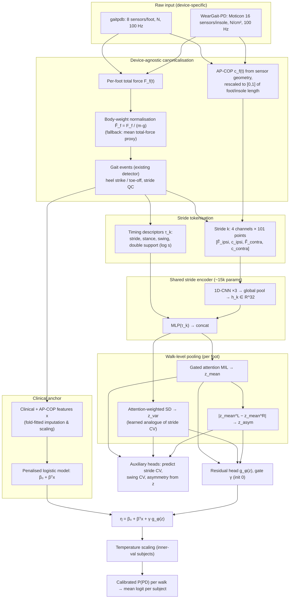

# Extending the Project — Research Investigation and Extension Plan

**Project:** Detecting Parkinson's Disease from Foot Pressure: a comparative study of deep learning and clinical gait features
**Prepared:** 18 November 2026 · **Status:** research only; no code has been changed · **Revision 2:** three base papers audited (§1.5); new P0 and Deliverable 10 ("What we can do now")
**Inputs read:**
- `PROJECT_OVERVIEW.md` and the repository code, including `results_pd/cv_results.json`
- The three base papers, read in full: Yuan et al. 2025 (*IEEE TNSRE*), Chen et al. 2025 (*IEEE TNNLS*), and Sepas-Moghaddam & Etemad 2023 (*IEEE TPAMI*)
- About 30 further papers, preprints, datasets and code repositories from 2017 to November 2026 (most from 2024–2026)

---

## 0. How to read this document

### 0.1 Evidence labels
Every claim about another paper carries a label that says how it was checked:

| Tag | Meaning |
|---|---|
| **[F]** | Full or near-full text read in this investigation |
| **[B]** | One of the three base papers you supplied as PDFs, read in full for revision 2 |
| **[P]** | Partly read: abstract plus part of the body read word for word; some numbers come from an automated extraction of the rest and need checking against the PDF |
| **[A]** | Only the abstract, index record or search snippet was available. Nature, MDPI, PubMed and Semantic Scholar blocked automated reading for several papers |
| **[S]** | Second-hand: the number is quoted by a survey or another paper |
| **[K]** | A standard methods reference, cited from established knowledge and not re-fetched here |
| **[O]** | Taken from our own `PROJECT_OVERVIEW.md` |

Statements are also marked as **Finding** (published by others or measured by us), **Interpretation** (my reading of the evidence) or **Hypothesis** (to be tested).

### 0.2 Important caveats
- **Revision 2:** the three base papers have now been read in full (§1.5).
  - Every claim about MSCAF-Gait in `PROJECT_OVERVIEW.md` was checked against the paper.
  - The architecture and training-setup descriptions are accurate. The few nuances are listed in §1.5.1.
  - The PDFs were attached in chat but are not in the repository. Consider saving them to a `papers/` folder.
- Several 2026 MDPI and Nature papers were readable only as abstracts. Before citing any **[A]** or **[P]** number in a manuscript, check it against the PDF.

---

## Executive summary

1. **Our "honest evaluation" contribution is no longer unique.** Since our main results were produced, at least four 2026 papers or preprints have evaluated gaitpdb at participant level. One preprint, Sifat et al. (arXiv 2609.22956) [P], reaches **AUC 0.894 with 10 centre-of-pressure (COP) features** and **AUC 0.908 with 35 features**, under repeated, fully nested participant-level CV. Its leave-one-study-out AUC is 0.907 and it reports Brier scores and calibration slopes. That beats our XGBoost (AUC 0.86). Our 13 features use only the total-force columns and ignore the 16 individual sensors. A comparative "features vs deep learning with an honest protocol" paper on gaitpdb alone would now be incremental.
2. **What is still open, and what we are well placed to do:**
   - **(a) External, cross-device validation.** Nobody has yet published a model trained on gaitpdb and tested on a different insole system and cohort. The new **WearGait-PD** dataset (Scientific Data 2026; Moticon 16-sensor insoles; 100 PD and 85 controls, verified in revision 3) makes this possible.
   - **(b) A deep model with the right temporal unit.** Every deep model in the literature classifies short windows (1–10 s). The strongest PD markers (swing-time variability, asymmetry) are defined over **many strides**.
   - **(c) Incremental value, confounding and calibration.** No one has formally tested whether deep representations add anything beyond clinical and COP features. Speed, protocol and site confounding have barely been examined. Calibration under distribution shift is almost never reported.
3. **The competition is moving.** A University of Calgary course project (public GitHub, not published) plans to test gaitpdb-trained timing-feature models on WearGait-PD. The Sifat et al. group has preprints on both gaitpdb (COP features) and WearGait-PD (site confounding). The external-validation idea on its own may be taken within months. **What sets us apart is combining it** with a clinically anchored stride-sequence deep model, calibration transfer and confound analysis.
4. **Recommendation (Section 9):** build a **Clinically-Anchored Stride-Sequence Network (CASS-Net)**:
   - It works on a **device-agnostic** per-stride representation: per-foot force divided by body weight, plus the front-to-back (anterior–posterior, AP) COP trajectory.
   - It pools over **all strides of a walk** with mean, variability and asymmetry pooling.
   - It adds a **gated residual** on top of a strong clinical and COP logistic model.
   - Evaluate it with nested subject-level CV, leave-one-study-out, and a **pre-registered external test on WearGait-PD** with per-site analysis and calibration.

   This turns our negative findings (deep learning lags, fusion fails, 10-s windows are too short) into testable hypotheses with a clear contribution.

**What reading the three base papers added (revision 2):**
- **MSCAF-Gait's own evidence comes almost entirely from leaky splits.**
  - Every architectural claim was measured under a random window split. This covers the ablation (Table VI), the kernel study (Table VII), the sensor-region study (Table VIII) and the t-SNE plots.
  - The test confusion matrices count 7,530 *windows*, which confirms the split was at window level.
  - Only one number is subject-independent: the full model's 82.31% leave-one-subject-out (LOSO) accuracy. No ablation was run under that protocol.
  - **A cheap experiment we can run immediately:** repeat MSCAF's own ablations with subject-level folds (new **P0**).
- **The base authors used two insole systems but never tested transfer between them.**
  - Their two datasets used different insoles: Ultraflex on gaitpdb, and Moticon OpenGo on their own PIAG dataset. OpenGo is the same device as in WearGait-PD.
  - Their stated future work names "domain adaptation" and "sensor placement optimization". P2 answers this directly.
- **Our MSCAF trained on only 99 people per fold.** The other 33 training-side subjects went to validation ([results_pd/cv_results.json](results_pd/cv_results.json)). The paper's LOSO trains on about 164. Part of our 65 vs 82 gap may therefore be training-set size. A learning curve will settle it.
- **Our MSCAF's decision threshold is unstable across folds.**
  - Window-level sensitivity per fold: 96.9, 55.2, 73.4, 34.6 and 91.9%.
  - Specificity per fold: 21.7, 91.2, 62.6, 78.6 and 52.7%.
  - This is direct evidence for the calibration gap (G6).
- **Chen et al.'s shallow feature-extraction (SFE) block ends with a max-pool *over frames*.**
  - That final pool is set pooling over time. Our 1-D adaptation replaced it with a third time-downsampling step.
  - The original design is a precedent for the set-of-strides pooling in CASS-Net.
- **Sepas-Moghaddam & Etemad back two of our directions:**
  - Pooled templates (set pooling) and part-based representations dominate the best gait-recognition models.
  - Cross-dataset evaluation had "not been performed" on the main vision datasets as of 2021.
  - Soft biometrics (age, height, weight, sex) can be recovered from gait, which supports our leakage and confound arguments.
- **Deliverable 10** lists what we can start this week, without WearGait-PD.

---

## Deliverable 1 — Assessment of the existing project

### 1.1 What is genuinely strong
| Strength | Why it matters |
|---|---|
| Strict person-level 5-fold CV, asserted disjoint, pooled out-of-fold predictions | This is the minimum standard for clinical ML (Saeb et al. 2017 [K]), and most of the gaitpdb literature does not meet it. The 2026 survey finds only 6% of 102 plantar-pressure PD studies use leave-one-dataset-out, and accuracy is the most-used metric (Wang, Zhao et al. 2026 [P]) |
| Leakage quantified on the same data (+19.2 points) | A direct, reproducible measurement. Most papers only assert that leakage exists. Our measurement agrees with the mechanism shown by Horst et al. 2019 [A]: gait patterns are individually unique, so models can recognise people |
| Leave-one-study-out (75.2% balanced accuracy) | Protocol shift (treadmill vs overground vs cued) is a real test of robustness |
| Out-of-fold explainability that recovers known clinical markers | Swing asymmetry, swing-time CV and double support. A University of Calgary course project independently finds swing-time asymmetry **alone** gives AUC 0.76 on gaitpdb [F, unpublished] |
| Honest negative results (fusion did not help; MSCAF lags) | Valuable. They also show exactly where the next contribution lies |
| Integrity fixes documented | Builds trust; reviewers value this |

### 1.2 What is weak, or now threatened by the literature
| Weakness | Evidence | Consequence |
|---|---|---|
| **Feature set is outdated.** It uses only total force: no COP, no per-sensor loading | Sifat et al. 2609.22956 [P]: 10 AP-COP features give AUC 0.894 vs 0.856 for 25 non-COP features; removing the COP features gives a statistically supported loss | A reviewer will say our "best model" is not state of the art for handcrafted features. Our 78.4% balanced accuracy is about 4–5 points below theirs (≈82–83% [P, extracted]) |
| **Walking conditions are mixed.** Features are averaged over *all* of a subject's walks, including Ju's rhythmic-auditory-cue walks (`_02`–`_07`) and Ga's dual-task walks (`_10`) ([gait_common.py:323-351](gait_common.py#L323-L351)) | Sifat et al. use only `_01` usual walking. Cueing and dual tasking change stride variability by design (Hausdorff 2007; Yogev 2005 [O]) | The number and kind of conditions differ by study and subject. This adds protocol noise and may be part of the leave-one-study-out threshold shift |
| **Gait speed is not controlled** | Sifat et al. [P, extracted]: walking speed alone gives AUC 0.772. Stride-time variability depends on speed, but swing-time variability does not (Frenkel-Toledo et al. 2005, JNER [K]) | Part of what we call "PD gait" may be "slow gait". This needs a speed-adjusted analysis |
| **The MSCAF reimplementation departs from the paper** | We added a shallow CNN (5× the parameters) and use 10-s windows, z-scoring and balanced accuracy, vs the paper's 1.6-s windows and Min-Max scaling [O] | A reviewer can argue we compared against a weakened MSCAF. We need a **faithful-configuration run** as a reference point, even if it also does poorly at subject level |
| **No uncertainty quantification or statistical tests** | Results are point estimates. The fold SD is reported, but there are no 95% CIs and no paired test of MSCAF vs XGBoost | With n = 165 the AUC CI half-width is about ±0.05. Some of our differences (fusion vs XGBoost) are probably not significant |
| **Hyperparameters are fixed, not nested** | No leakage, which is good, but the tree models are probably not tuned optimally | Fine as a baseline. An extension should use nested tuning |
| **Calibration not measured** | Overview §7.5 notes MSCAF probabilities above 0.999 | Calibration is a TRIPOD+AI reporting item (Collins et al. 2024 [K]) |
| **One dataset, one lab** | Acknowledged | The main limit on generalisation claims |
| **MSCAF trains on only 99 people per fold** | 5-fold CV with a 33-subject validation split (`n_train_subjects = 99` in [results_pd/cv_results.json](results_pd/cv_results.json)). The base paper's LOSO trains on about 164 people [B] | Part of the 65.3% vs 82.31% gap may be training-set size, not architecture. Needs a learning curve (N13) |
| **Decision threshold unstable across folds** | MSCAF window-level sensitivity per fold: 96.9 / 55.2 / 73.4 / 34.6 / 91.9%. Specificity: 21.7 / 91.2 / 62.6 / 78.6 / 52.7%. Mean window AUC 0.79 | Ranking ability is moderate, but the 0.5 threshold is unreliable. Direct evidence for G6 (calibration) |
| **"SFE from Chen et al." is an adaptation, not a copy** | Chen et al. Table I [B]: four 2-D convolutions on 64×44 silhouettes, two spatial max-pools, then a max-pool *over frames* (set pooling). Ours: 1-D convolutions over time with three time max-pools | Describe it as "adapted from" in the paper, and say that the final frame-set pool was replaced (§1.5.2) |

### 1.3 Where our numbers sit among subject-level gaitpdb results
| Work | Unit / protocol | Result |
|---|---|---|
| **Ours: XGBoost, 13 features** [O] | 5-fold person-level, pooled OOF | BAcc 78.4, AUC 0.86 |
| **Ours: MSCAF-Gait** [O] | Same | BAcc 65.3, AUC 0.73 |
| Sifat et al. 2026, AP-COP10 [P] | 20×5 repeated nested participant CV, `_01` only | AUC 0.894; BAcc ≈ 0.83 (extracted) |
| Sifat et al. 2026, leave-one-study-out [P, extracted] | Train on 2 studies, test on the third | Pooled AUC 0.907 (Ga 0.837, Ju 0.937, Si 0.946) |
| UCalgary course project [F, unpublished] | Participant-grouped repeated CV, age ≥ 50 | Logistic regression on 6 timing features: AUC 0.82 (within protocol), 0.77 (study held out) |
| Yuan et al. 2025, MSCAF (base paper) [B] | LOSO: 165 one-subject folds, plain accuracy averaged over folds, ≈164 training subjects | 82.31% accuracy (best LOSO baseline in the paper, CNN-CBAM: 76.03%) |
| Ours, MSCAF, same unit as the base paper's per-fold score (window level) [results_pd] | 5-fold, 99 training subjects | Window accuracy 67.6%, window balanced accuracy 65.9%, window AUC 0.79 |
| Choi et al. 2026 [P] | 1-s windows, 5 random subject-wise 70/15/15 splits | AUC 0.934–0.940, accuracy 0.84–0.86 (unit of evaluation unclear) |
| Coser et al. 2026 (preprint) [P] | Repeated subject-wise splits, Transformer with masked self-pretraining | Accuracy 0.895 → 0.974 with pretraining (extracted; unverified) |
| Fu et al. 2026, CNN-GRU-KAN [F] | "10-fold by patient ID" plus leave-one-dataset-out | 98.43% pooled; **leave-one-dataset-out 97.9–98.3%, higher than its within-cohort results (94.7–97.9%)** |

**Interpretation.** Feature-based, participant-level results now cluster at **AUC 0.82–0.91**. Deep models that claim "subject-level" results range from **0.73 (ours) to about 98%**. Larger models alone cannot explain a 25-point spread. More likely explanations are protocol differences: window-level scoring, model selection on test subjects, random splits mislabelled as subject-wise, or condition mixing. CNN-GRU-KAN's cross-cohort accuracy beating its within-cohort accuracy is a red flag. Its text also mislabels the cohorts: it calls Ju "dual-task", whereas Ga is the dual-task study. This dispersion is itself a research gap (G4).

### 1.5 Audit of the three base papers (revision 2)

#### 1.5.1 Yuan et al. 2025 — MSCAF-Gait (*IEEE TNSRE* 33:3146–3159, [doi:10.1109/TNSRE.2025.3597639](https://doi.org/10.1109/TNSRE.2025.3597639)) [B]

**What the paper does (checked against the PDF)**
| Aspect | Verified content |
|---|---|
| Data: GaitinPD | 93 PD and 73 controls; 8 sensors per insole; 100 Hz |
| Data: PIAG (new) | 12 **healthy** adults aged 22–26 *imitating* 11 gaits: 4 normal speeds including running, plus 7 clinically inspired abnormal gaits. Recorded with Moticon OpenGo insoles (16 sensors per insole, 100 Hz) in a 60 m corridor. I found no data-availability statement in the paper and no public copy in search |
| Preprocessing | Min-Max normalisation of raw pressure "before segmentation". Its scope (per channel, per recording or across the whole dataset) is not stated. Windows: 1,600 ms for GaitinPD, 2,000 ms for PIAG, both with 50% overlap |
| Split | "randomly split into training, validation, and testing sets in a 6:2:2 ratio". PIAG Table I: 10,248 / 3,416 / 3,416 **windows**. GaitinPD test confusion matrices sum to 7,530 windows. So the split is at window level |
| Tuning | Optuna, 20 trials, maximising validation accuracy on the random split. Selected: learning rate 1.9×10⁻⁴, batch 128 |
| Headline results | 99.61% (control vs PD). 98.88% on 4 classes (control, H&Y 2, 2.5, 3). PIAG: 99.42% |
| LOSO (Table V) | GaitinPD 82.31% and PIAG 77.62%. GaitinPD baselines: CNN-LSTM 71.41, CNN-SENet 74.20, CNN-CBAM 76.03, CNN-self-attention 71.28. Parameters: 0.08 M (GaitinPD) and 0.22 M (PIAG) |
| Evidence for each component | Ablations (Table VI, 98.54–99.61%), kernel sets (Table VII), foot regions (Table VIII, PIAG only) and t-SNE (PIAG training set). **All under the random split** |
| Stated limits and future work | Accuracy drops under LOSO; severity classes are imbalanced. Future work: "enhanced regularization, domain adaptation, and meta-learning, as well as exploring sensor placement optimization" |

**Critical observations (interpretation)**
1. **The component claims rest on a leaky protocol.**
   - The ablation differences (≤ 1.1 points) were measured at about 99% accuracy, a regime where models can recognise individuals.
   - Nobody has tested whether multi-scale convolution, the channel/spatial attention pair or cross-attention help on *unseen people*.
   - Our code already has a `fusion='add'` switch, so this is cheap to test (P0, N11).
2. **The LOSO number is not directly comparable to ours.**
   - It is plain accuracy averaged over 165 one-subject folds.
   - The paper does not say whether each fold's accuracy is computed over windows or as a subject-level vote. With one subject per fold, a vote would give only 0% or 100%, so the average is most plausibly the mean per-subject window accuracy.
   - The paper also does not describe whether the Optuna hyperparameters (tuned on the random split) and checkpoint selection were reused under LOSO.
   - Training-set sizes differ: about 164 people vs our 99.
   - N9 reconciles the metrics.
3. **The "severity" task is mostly a diagnosis task.**
   - Of the 7,530 test windows, 2,327 are controls.
   - Windows from the same person appear in both training and test.
   - So the 98.88% does not show an ability to stage the disease.
4. **Two devices, no transfer test.** GaitinPD (Ultraflex, 8 sensors per foot) and PIAG (OpenGo, 16 sensors per insole) are evaluated separately. PIAG uses the same device as WearGait-PD. Testing transfer is a natural extension, and the paper's own future work points towards it.
5. **PIAG is imitated pathology by young healthy adults.** It is not clinical evidence. At most it is a sample of the OpenGo device domain.
6. **The paper argues against gait-cycle segmentation for real-time use.** It criticises Liu et al. for "threshold-based" cycle extraction. CASS-Net depends on stride segmentation, so we must show it is cheap and works on a live stream (§7.6).
7. **Strengths worth keeping:**
   - The model is lightweight, and the paper shows real-time inference (41.24 ms on a Raspberry Pi 4B).
   - It states openly that LOSO accuracy is lower.
   - The regional sensor analysis is a good idea that deserves a subject-level re-run.

**Check of `PROJECT_OVERVIEW.md`:**
- All architecture and setup rows are correct.
- Three nuances to add:
  - The 0.08 M parameter count is for the GaitinPD configuration (0.22 M for PIAG).
  - The 82.31% is plain accuracy averaged over LOSO folds.
  - The H&Y task includes controls and only stages 2–3.

#### 1.5.2 Chen, Zhao, Li 2025 — *Adaptive Gait Feature Learning Using Mixed Gait Sequence* (*IEEE TNNLS* 36(1):1545–1554, [doi:10.1109/TNNLS.2023.3331050](https://doi.org/10.1109/TNNLS.2023.3331050)) [B]

**What the paper does**
- **Task:** identifying *people* from video silhouettes.
  - CASIA-B: 124 subjects, 74 for training and 50 for testing.
  - mini-OUMVLP: the first 500 subjects of OU-MVLP, 350 train and 150 test.
  - Rank-1 accuracy on CASIA-B: 97.2% normal walking (NM), 93.5% with a bag (BG), 79.4% with a coat (CL).
- **Four modules:**
  - **GSM (gait sequence mixing):** builds new training sequences by mixing frames from the same subject's NM sequence and bag or coat sequence at the same camera view. It is a data augmentation.
  - **SFE (shallow feature extraction):** four convolutions (32/64/128/128 channels; kernels 5/3/3/3), dropout 0.2, two spatial max-pools, then a max-pool over frames.
  - **MFE (multi-granularity feature extraction):** splits the feature map into 1 + 2 + 4 + 8 horizontal strips, applies a convolution and average + max pooling to each strip, and concatenates the results. Trained with a triplet loss (margin 0.2).
  - **FDA (feature distance alignment):** at test time, adjusts distances using an "adjustment set" of unlabelled features. The paper's experiments use the **test-set sequences** as this set, which makes it transductive.

**Why it matters to us**
1. **It shows the leakage mechanism.** It is an identification paper: a small CNN extracts enough identity information to recognise 50 unseen people with 97% rank-1 accuracy. That is why random window splits leak.
2. **Our SFE adaptation.** As noted in §1.2, the original's last pool is set pooling over time, which does not depend on frame order. CASS-Net applies the same inductive bias at the stride level.
3. **Transferable ideas.** Each is worth testing as an *ablation*, not a headline:
   - **GSM → within-subject condition mixing.**
     - Splice strides from the same training subject's usual walk with their dual-task (Ga) or cued (Ju) walks.
     - It preserves the label, because diagnosis is per person.
     - It may teach invariance to walking condition, which is the shift tested by leave-one-study-out.
     - Mixing must stay within training subjects (A11).
   - **MFE → multi-granularity foot regions.**
     - Whole foot (1) + rear/fore (2) + heel/arch/metatarsal heads/toes (4).
     - The base paper already groups the Moticon sensors into these four regions (its Fig. 15).
     - Regional forces could therefore be a device-agnostic middle ground between total force and raw sensors (A4).
   - **Triplet / identity loss → identity probe and identity-adversarial training.**
     - Add a subject-ID head trained through a gradient-reversal layer, so the network is discouraged from memorising subjects (A12).
     - Closest wearable-PD precedent: arXiv 2510.10558 [A], which uses an adversarial classifier for subject invariance.
   - **FDA → unsupervised test-time alignment.** Align target-domain feature statistics using unlabelled external data. Use it only as a clearly labelled transductive analysis in the external test, never as the primary result.

#### 1.5.3 Sepas-Moghaddam & Etemad 2023 — *Deep Gait Recognition: A Survey* (*IEEE TPAMI* 45(1):264–284, [doi:10.1109/TPAMI.2022.3151865](https://doi.org/10.1109/TPAMI.2022.3151865)) [B]

**Scope.** Vision-based identification, covering papers up to January 2021. It classifies methods along four dimensions:
- body representation (silhouette or skeleton)
- temporal representation (pooled templates vs ordered sequence volumes)
- feature representation (global or part-based)
- neural architecture

**Relevant findings**
1. **Protocols.** It distinguishes subject-dependent from subject-independent protocols (its Fig. 3). *Caveat:* these are defined for identification, with gallery and probe sets. Cite the survey for the concept, but define our diagnostic protocol explicitly.
2. **Templates and part-based features.**
   - About 70% of methods use templates, including "convolutional templates" (set pooling, as in GaitSet). Several top performers use them.
   - The best methods also use part-based representations (GaitSet, GaitPart, GLN).
   - *Mapping to our work:* MSCAF and other window models are "sequence volumes". CASS-Net is a convolutional template at the stride level, with optional part-based (regional) channels.
3. **Open challenges (§7):**
   - disentangling identity from covariates
   - self-supervision and multi-task learning
   - domain adaptation
   - **cross-dataset evaluation**, which "has not been performed" on the main datasets and is framed as out-of-distribution testing
   - soft biometrics (age, height, weight, gender), which are recoverable from gait

**Why it matters.**
- It supports P1 (set/template pooling, part-based features) and P2 (cross-dataset out-of-distribution testing).
- It supports our leakage and confound argument, because soft biometrics such as body weight are encoded in gait.
- Its §7.2 recommendation for self-supervision is generic. Our evidence (§2.2-D) says self-supervision has low expected value at our label budget.

#### 1.5.4 Net effect on the plan
| Plan element | Change after reading the base papers |
|---|---|
| **New P0** | Subject-level re-audit of MSCAF-Gait: faithful configuration, the paper's own ablations, window length, learning curve, metric reconciliation. Doable immediately, and it directly answers the base paper |
| P1 CASS-Net | Add regional-force channels (from base paper Fig. 15 and Chen's MFE). Add a streaming-latency evaluation to answer the base paper's deployment objection. Cite GaitSet and Chen's frame pooling as precedent for set pooling |
| P2 external validation | New framing: "the base paper used both device families but never tested transfer". WearGait-PD uses the base paper's own PIAG device |
| Ablations | Add within-subject condition mixing (A11), identity-adversarial training (A12) and regional channels (A4) |
| Deprioritised | Meta-learning (the base paper's suggestion): there is one label per person and only 3 small source domains, so there is no episodic structure worth learning |

---

## Deliverable 2 — Literature review

### 2.1 Summary table (most relevant first)
| # | Paper | Venue / status | Data (n) | Input | Model | Protocol | Headline metric | Tag |
|---|---|---|---|---|---|---|---|---|
| B1 | Yuan, Wang, Zhou et al. — *Foot Pressure-Based Abnormal Gait Recognition With Multi-Scale Cross-Attention Fusion* (base paper) | IEEE TNSRE 33:3146–3159, 2025. [doi:10.1109/TNSRE.2025.3597639](https://doi.org/10.1109/TNSRE.2025.3597639) | GaitinPD 166 (93/73); PIAG: 12 healthy adults imitating 11 gaits | 1.6-s / 2-s windows; 16 / 32 sensors; Min-Max | MSCAF-Gait (multi-scale conv + channel/spatial attention + cross-attention); 0.08–0.22 M parameters | Random 6:2:2 window split; LOSO as secondary | 99.61% (random split); 82.31% LOSO accuracy | B |
| B2 | Chen, Zhao, Li — *Adaptive Gait Feature Learning Using Mixed Gait Sequence* | IEEE TNNLS 36(1):1545–1554, 2025. [doi:10.1109/TNNLS.2023.3331050](https://doi.org/10.1109/TNNLS.2023.3331050) | CASIA-B 124 (74 train / 50 test); mini-OUMVLP 500 (350 / 150) | Video silhouettes, 64×44, 50 frames | SFE + GSM + MFE + FDA; triplet loss | Subject-disjoint identification (gallery / probe) | Rank-1 on CASIA-B: NM 97.2, BG 93.5, CL 79.4 | B |
| B3 | Sepas-Moghaddam, Etemad — *Deep Gait Recognition: A Survey* | IEEE TPAMI 45(1):264–284, 2023. [doi:10.1109/TPAMI.2022.3151865](https://doi.org/10.1109/TPAMI.2022.3151865) | 15 vision datasets surveyed | — | Four-dimension taxonomy | Defines subject-dependent vs subject-independent protocols | Covers papers to Jan 2021 | B |
| 1 | Sifat, Akter, Islam, Hamid — *A Compact Stance-Indexed AP-COP Representation for PD Classification from Plantar VGRF* | arXiv 2609.22956, Sep 2026 (preprint) | gaitpdb, 165 (93/72), `_01` only | 10 stance-indexed AP-COP features; 35-feature pool | Elastic-net stability selection → L2 logistic regression (≤6 features) | 20×5 nested participant CV; leave-one-study-out; bootstrap CIs; Holm correction | AUC 0.894 (AP-COP10), 0.908 (Full35); leave-one-study-out AUC 0.907; Brier 0.135 | P |
| 2 | Sifat et al. — *When Participant Disjoint Validation Is Not Enough to Establish Generalization in Parkinson's Gait Classification* | arXiv 2610.16220, 2026 (preprint) | WearGait-PD walkway, 133 (65/68), 3 sites | 159 walkway gait metrics | L1 logistic regression | 20×5 participant CV; cross-site transport | **Site alone AUC 0.955**; gait features 0.882; cross-site transport **0.576** | P |
| 3 | Jin — *Identifying PD from Gait Biomechanics Using a Participant-Level ML Analysis Pipeline* | Applied Sciences 16(13):6296, 2026. [doi:10.3390/app16136296](https://doi.org/10.3390/app16136296) | gaitpdb, 165 | Bilateral VGRF features incl. COP variability | HistGradientBoosting (best) | Repeated, fully nested participant CV; protocol-subset hold-out | AUC 0.992 *with UPDRS/H&Y as inputs* (label proxies); gait-only hold-out AUC 0.844; leave-one-study-out AUC 0.500–1.000 | A (Crossref abstract) |
| 4 | Choi, Jo, Jeong — *Digital Gait Biomarkers for PD: Subject-Wise Validated XAI Framework Using VGRF* | Bioengineering 13(3):360, 2026. [doi:10.3390/bioengineering13030360](https://doi.org/10.3390/bioengineering13030360) | gaitpdb, 166 | 1-s windows, per-sensor mean/SD tokens | TCN, BiGRU-Attn, FCNN-Transformer; XGBoost for H&Y | 5 repeated subject-wise random splits | AUC 0.934–0.940; H&Y R² 0.953 | P |
| 5 | Fu, Jiang, Al-qaness — *CNN-GRU-KAN* | Bioengineering 13(8):905, 2026. [doi:10.3390/bioengineering13080905](https://doi.org/10.3390/bioengineering13080905) | gaitpdb, 166 | 1-s windows, 18 channels, no body-weight normalisation | CNN + BiGRU + KAN head | "10-fold by patient ID"; leave-one-dataset-out | 98.43% accuracy; leave-one-dataset-out ≈98%; 5-class UPDRS 93.46% | F |
| 6 | Wang X., Zhou, Zhao, Zhang, Li, Qi — *Global-Local Dynamic Directed GNN for PD Detection* | IEEE TNSRE 33:3947–3957, 2025. [doi:10.1109/TNSRE.2025.3614430](https://doi.org/10.1109/TNSRE.2025.3614430) | gaitpdb | VGRF sensor graph | Dynamic directed GNN | Includes leave-one-dataset-out per the survey | Leave-one-dataset-out Ga→Ju 0.812 [S] | A/S |
| 7 | Wang X., Zhao Z. et al. — *Comprehensive survey on diagnosis and assessment of PD via plantar pressure analysis* | npj Parkinson's Disease 12:229, 2026. [doi:10.1038/s41531-026-01416-6](https://doi.org/10.1038/s41531-026-01416-6) | 102 studies (2008 to Oct 2025) | — | — | PRISMA review | 82/102 studies use gaitpdb; K-fold 54%, leave-one-dataset-out 6%; poor external generalisation flagged | P |
| 8 | Anderson, Eguren, Gonzalez et al. — *WearGait-PD* | Scientific Data 13:440, 2026. [doi:10.1038/s41597-026-06806-2](https://doi.org/10.1038/s41597-026-06806-2) | 100 PD (age 67 ± 8) / 85 controls (age 74 ± 9), verified; analysis subsets are smaller | Moticon 16-sensor insoles, full-body IMUs, walkway, video | Dataset | — | MDS-UPDRS, medications, DBS status; Synapse syn52540892 | F (PMC13009270) |
| 9 | Coser, Orvieto, Soda, Zollo — *Is Self-Pretraining really useful to improve diagnosis in medical Time Series?* | arXiv 2608.06122, Aug 2026 (preprint) | gaitpdb 166, plus 2 others | Windows | Transformer with masked-reconstruction self-pretraining (same dataset) | Repeated subject-wise splits | Gains of 0–6 points (abstract); gaitpdb 0.895 → 0.974 (extracted) | P |
| 10 | Zannat — *Label-Efficient Bilateral Attention for PD Screening from Wrist-Worn IMU Signals* | arXiv 2604.18372, 2026 (preprint) | PADS, 469 | Wrist IMU | Transformer + SimCLR-style contrastive learning | Patient-disjoint 5-fold | Self-supervision helps only at ≤10% labels (+9.8 pts at 5%); none at ≥20% | P |
| 11 | Datta, Miranda Soberanis — *Quantifying Methodological Inflation in Clinical ML* | arXiv 2611.14533, 2026 (preprint) | Voice, telemonitoring, blood (no gait) | — | Elastic net, RF | Record-wise vs subject-wise; pre-split feature selection | Voice AUC 0.892 → 0.780 under subject splits; selection before splitting inflates 0.711 → 0.998 | P |
| 12 | Sigcha, Borzì, Olmo — *Deep learning for freezing of gait detection: a cross-dataset study* | Expert Systems with Applications, 2024 | Several freezing-of-gait datasets | IMU | Several deep models | Cross-dataset | Cross-dataset AUC 0.65–0.84 vs 0.77–0.94 within dataset | A |
| 13 | Yu et al. — *Dual-Task Gait Fusion Framework for Classifying PD Severity* | Diagnostics 16(15):2386, 2026. [doi:10.3390/diagnostics16152386](https://doi.org/10.3390/diagnostics16152386) | WearGait-PD (PD only) | Two walking tasks | Two-branch temporal encoders | Has an "External Validation on an Independent PD Gait Dataset" section | Internal BAcc 89.6% (87 PD, 3 classes). "External" gaitpdb accuracy 84.3% on 2 classes, but the model uses 66 IMU + pressure channels and the paper does not explain how it was applied to 16-channel VGRF | F |
| 14 | *Physiology-Anchored Multiple-Instance Framework (PAS-MIL)* | Applied Sciences 16(17):8354, 2026 | gaitpdb, 306 sessions / 165 participants | Bags of temporal windows + 8 predefined bilateral descriptors | Attention-MIL with concept, prototype and static-feature expert pathways; distillation from inner out-of-fold ExtraTrees | 5-fold person-grouped CV | Pooled session AUC 0.771; mean fold AUC 0.826; ECE 0.291 | A (Crossref abstract) |
| 15 | *Self-Explaining Neural Networks for Transparent PD Screening* | Sensors 26(9):2671, 2026. [doi:10.3390/s26092671](https://doi.org/10.3390/s26092671) | gaitpdb, "306 subjects" (actually 306 recordings) | 1.28-s windows | Residual CNN + 16-concept encoder | 70/15/15 split over the 306 units, so the same person can appear in train and test | Subject-level AUC 0.916, probably inflated | F |
| 16 | *Multi-Task Wearable PD Detection with a Pretrained ST-GCN Encoder* | Bioengineering 13(8):860, 2026. [doi:10.3390/bioengineering13080860](https://doi.org/10.3390/bioengineering13080860) | WearGait-PD (13 body IMUs) | Task-level tokens | Frozen ST-GCN + 3-layer transformer | Not retrieved | BAcc 0.834 ± 0.087, AUC 0.842 | A |
| 17 | FM-FoG (arXiv 2509.24176, 2025, preprint) | — | Freezing-of-gait IMU | — | Domain-specific foundation model vs general time-series models | — | Domain-specific 98.5 F1 vs MOMENT 85.9 F1 | A |
| 18 | Horst, Lapuschkin, Samek, Müller, Schöllhorn — *Explaining the unique nature of individual gait patterns with deep learning* | Scientific Reports 9:2391, 2019. [doi:10.1038/s41598-019-38748-8](https://doi.org/10.1038/s41598-019-38748-8) | 57 healthy | GRF + joint angles | CNN/MLP + LRP | — | Individuals are identifiable from gait | A |
| 19 | UCalgary BMEN 600 Group 5 — *Parkinsons-Gait-Generalization* | GitHub, Fall 2026 (unpublished course project) | gaitpdb (age ≥ 50: 91/71) + WearGait-PD (planned) | Timing features from total force | LR, SVM, RF | Grouped CV, leave-one-study-out; **planned gaitpdb → WearGait-PD test** | AUC 0.82 within, 0.77 study held out; external result not yet reported | F |

**Earlier work cited in the base paper's comparison table** (Table III [B]):
- Daliri 2013
- Açıcı et al. 2017
- Veeraragavan et al. 2020
- Xia et al. 2020 (*IEEE TNSRE*)
- Liu et al. 2021
- Nguyen et al. 2022 (Transformers; ICPR 2022)
- Naimi et al. 2023 (HCT; ICMLA 2023; arXiv 2310.17078)

The base paper quotes their accuracies without re-running them. Most use random or window-level splits. El Maachi et al. 2020 is also widely cited.

**Standard methods referenced in the proposals** [K]:
- Leakage and reporting: Saeb et al. 2017, GigaScience; Kapoor & Narayanan 2023, Patterns; TRIPOD+AI (Collins et al. 2024, BMJ)
- Calibration and clinical utility: Guo et al. 2017, ICML (calibration); Van Calster et al. 2019, BMC Medicine; Vickers & Elkin 2006 (decision curves); Angelopoulos & Bates 2023 (conformal prediction)
- Architectures: Ilse et al. 2018, ICML (attention MIL); Koh et al. 2020, ICML (concept bottlenecks); Perez et al. 2018 (FiLM)
- Domain generalisation: Ganin et al. 2016, JMLR (DANN); Sagawa et al. 2020, ICLR (GroupDRO); Gulrajani & Lopez-Paz 2021, ICLR (ERM is a strong domain-generalisation baseline)
- Self-supervision and foundation models: Yue et al. 2022 (TS2Vec); Nie et al. 2023 (PatchTST); Goswami et al. 2024 (MOMENT); Yuan H. et al. 2024, npj Digital Medicine (wearable self-supervised learning at UK-Biobank scale)
- Gait science and statistics: Hausdorff 2009, Chaos (PD gait variability); Hof 1996 (dimensionless gait scaling); DeLong et al. 1988; Nadeau & Bengio 2003 (corrected resampled t-test)

### 2.2 What the literature says, by topic (A–J)
**A/B. PD detection from gait and plantar pressure.**
- *Finding:* gaitpdb dominates the field (82 of 102 studies), and 2025–26 papers still report 97–99.9% accuracy, mostly with K-fold or hold-out splits whose subject-independence is not stated (survey [P]).
- *Finding:* a new 2026 wave evaluates rigorously at participant level: Sifat, Jin, Choi, and the course project. Feature models reach AUC 0.82–0.91, and COP descriptors carry information beyond timing.
- *Interpretation:* the field is splitting into a high-claim window-level track and a rigorous participant-level track. Our work belongs to the second track, which is growing quickly.

**C. Deep learning for biomedical time series.**
- All deep gaitpdb models found here work on windows of 1–10 s: MSCAF (1.6 s), Choi (1 s), CNN-GRU-KAN (1 s), ours (10 s).
- *Finding (ours):* 10 s ≈ 8 strides per foot. *Interpretation:* this is the wrong temporal unit for variability markers.

**D. Self-supervised learning.**
- *Finding:* the 2026 evidence is in-domain only. Coser et al. pretrain on the target dataset itself. Zannat finds contrastive learning helps only when 5–10% of labels are available.
- *Finding:* domain-specific pretraining beats general time-series foundation models for gait (FM-FoG [A]).
- *Interpretation:* with 165 labelled subjects, all of them labelled, the low-label regime where self-supervision helps does not apply, unless pretraining uses *external* unlabelled walks.

**E. Transformers and efficient attention.**
- Transformers on gaitpdb (Nguyen 2022; Naimi 2023; Choi 2026) did not show subject-level advantages over simpler models.
- *Interpretation:* attention over **stride tokens** (about 100 per walk) is a sensible use. Attention over raw samples (12,000 per walk) is not justified at n = 165.

**F. Multimodal and hybrid architectures.**
- Hybrid deep + handcrafted designs exist: PAS-MIL with 34 gait features and concept-bottleneck paths [A]; SENN with 16 concepts [A].
- None found uses a **residual design** in which the deep branch must explain what a strong clinical model misses, with the added value tested formally.

**G. Explainable AI.**
- *Finding:* Choi uses Integrated Gradients; the survey calls for "pathophysiology-consistent" explanations.
- *Finding (ours):* SHAP and occlusion give different rankings depending on the metric.
- *Gap:* explanations are rarely checked for stability across folds or for agreement with clinical markers.

**H. Domain adaptation and generalisation.**
- *Finding:* cross-dataset performance drops sharply: freezing-of-gait AUC from 0.77–0.94 to 0.65–0.84 (Sigcha 2024).
- *Finding:* in WearGait-PD, **site alone** predicts diagnosis with AUC 0.955, because only one of three sites recruited both groups. Cross-site transport falls to AUC 0.576 (Sifat 2610.16220 [P]).
- *Interpretation:* any external validation on WearGait-PD **must** report results per site and within the one mixed site. Pooled AUC could be inflated by site artefacts, or deflated.

**I. Few-shot and transfer learning.**
- Diagnosis has no natural few-shot structure: there is one label per person.
- Few-shot ideas are useful only for **target-domain recalibration**: adapting the threshold or temperature using a handful of labelled subjects from a new device.

**J. Physics-informed and clinically informed learning.**
- No convincing physics-informed neural network (PINN) formulation for plantar-pressure diagnosis was found. There is no governing equation whose residual would constrain a classifier.
- *Interpretation:* the defensible version is a **clinically and biomechanically structured representation*:*
  - gait-event segmentation
  - body-weight normalisation (Hof 1996)
  - COP derived from sensor geometry
  - consistency constraints (sensor sum = total force)

  This should be called "clinically informed", not "physics-informed".

---

## Deliverable 3 — Research gap analysis (ranked by significance × feasibility)

| Rank | Gap | Significance | Feasibility | Data |
|---|---|---|---|---|
| G0 | MSCAF-Gait's component claims were measured only under random window splits | ★★★★ | ★★★★★ | Existing |
| G1 | No published cross-device external validation of gaitpdb-trained models | ★★★★★ | ★★★★ | + WearGait-PD (public, registration) |
| G2 | Deep models use the wrong temporal unit (windows, not stride sequences) | ★★★★★ | ★★★★ | Existing |
| G3 | Incremental value of deep representations beyond clinical + COP features never formally tested | ★★★★ | ★★★★★ | Existing |
| G4 | Unexplained 25-point dispersion of "subject-level" claims; no unified re-evaluation | ★★★★ | ★★★ | Existing |
| G5 | Confounding by speed, body size, protocol and walking condition not disentangled | ★★★★ | ★★★★★ | Existing (+ WearGait) |
| G6 | Calibration and threshold transfer under shift are unreported | ★★★ | ★★★★★ | Existing (+ WearGait) |
| G7 | Input normalisation choices (z-score vs body weight) are unstudied for generalisation and identity leakage | ★★★ | ★★★★★ | Existing |
| G8 | Explanations not checked for faithfulness, stability or clinical alignment | ★★★ | ★★★★ | Existing |
| G9 | Severity estimation evaluated with weak protocols | ★★★ | ★★ | Existing (limited) |
| G10 | Self-supervised learning only tested in-domain; no external unlabelled pretraining for plantar pressure | ★★ | ★★ | + WearGait-PD (unlabelled use) |
| G11 | Domain-generalisation algorithms untested on gaitpdb studies | ★★ | ★★★ | Existing |

### G0 — MSCAF-Gait's components were never tested on unseen people (from the base-paper audit)
1. **What exists.** The base paper's ablations (Tables VI–VIII) and t-SNE all use random window splits. Under LOSO, only the full model and four baselines were reported, with plain accuracy and no confidence intervals [B].
2. **What is unresolved.** Do multi-scale convolution, channel and spatial attention, cross-attention fusion, kernel choice and sensor region matter for people the model has never seen? A 76.03% vs 82.31% LOSO gap over 165 people, without CIs, may not be significant.
3. **Why it matters.** The base paper's contribution claims rest on these ablations, and the same pattern runs through most architecture papers on gaitpdb.
4. **How we address it.** Re-run the ablations with our subject-level folds and 3 seeds, report CIs, and add a faithful configuration of the paper's model (P0).
5. **Contribution.** A clear answer to "which components survive honest evaluation?" This is a short, clean result that can open the main paper or stand alone as a conference paper.
6. **Experiments.** N9–N13 in Deliverable 10.

### G1 — Cross-device external validation
1. **What exists.**
   - The base paper itself evaluated two insole systems, GaitinPD (Ultraflex) and PIAG (Moticon OpenGo), but separately, with no transfer test [B]. gaitpdb-internal validation, including leave-one-study-out in Sifat, Fu and Wang. WearGait-PD-internal validation (Sifat 2610.16220; the ST-GCN paper). Yu et al. 2026 train on WearGait-PD (PD only, severity) and report an external validation section; I could not retrieve its dataset or results. A course project *plans* gaitpdb → WearGait-PD with timing features.
2. **What is unresolved.** Do plantar-pressure PD models transfer across **device** (Infotronic Ultraflex, 8 sensors per foot, newtons, vs Moticon OpenGo, 16 sensors per insole, 0.25 N/cm² resolution, COP as % of insole length [A, Moticon specs]), **country and cohort** (Tel Aviv vs US sites), and **protocol** (about 2 min continuous walking vs walkway passes)? Which representations transfer: timing, COP, raw sensors, or deep embeddings?
3. **Why it matters.** Every gaitpdb result, including ours, comes from one lab. The survey's main stated challenge is poor external generalisation.
4. **How we address it.** Build a device-agnostic representation, train on gaitpdb, freeze the model, and test once on WearGait-PD. Report pooled, per-site and within-mixed-site results.
5. **Contribution.** The first cross-device external test of plantar-pressure PD classifiers, and the first measurement of which representation level survives a device change.
6. **Experiments.** Required:
   - Harmonisation checks: event detection validated against the WearGait-PD walkway contacts.
   - External metrics with bootstrap CIs.
   - Per-site and within-VA-Seattle analysis (the one site with both groups).
   - Calibration before and after recalibration on k target subjects.
   - Reverse direction (WearGait-PD → gaitpdb) as a secondary analysis.

### G2 — Wrong temporal unit for deep models
1. **What exists.** Window classifiers of 1–10 s, with majority vote over windows. PAS-MIL does session-level MIL [A], but its instance definition and data could not be checked.
2. **What is unresolved.** No deep model found treats a **walk as a set or sequence of detected strides** and pools *variability* and *asymmetry* explicitly. Majority voting throws away exactly the across-stride dispersion that defines stride-time CV and swing-time CV.
3. **Why it matters.** It is the most likely mechanistic reason our deep model lags. It applies to *every* published deep model.
4. **How we address it.** Stride tokenisation (we already detect strides in [gait_common.py](gait_common.py)) → small shared stride encoder → attention-MIL with mean, variability and asymmetry pooling.
5. **Contribution.** A deep model whose inductive bias matches the clinical definition of PD gait markers, plus a **test of the temporal-context hypothesis**: performance as a function of the number of strides K.
6. **Experiments.** K-curve (K = 4, 8, 16, 32, 64, all). Window vs stride-token with the same encoder. Pooling ablations.

### G3 — Incremental value of deep representations
1. **What exists.** Papers report deep models alone or features alone. Our late fusion averaged probabilities and lost accuracy.
2. **What is unresolved.** Does a learned representation carry *any* PD information not already in clinical and COP features? Averaging is the wrong test, because it gives equal weight to a weaker model.
3. **Why it matters.** It answers the field's central question — "is deep learning needed for plantar-pressure PD detection?" — with a defensible yes or no.
4. **How we address it.** A residual (offset) model whose deep branch starts at zero contribution. Formal comparison of nested models (likelihood-ratio test, ΔAUC, Δlog-loss, net reclassification). Linear probing of embeddings for clinical features.
5. **Contribution.** A quantitative answer either way. A well-powered null result is publishable when framed as "deep learning adds ≤ X AUC beyond clinical markers".
6. **Experiments.** Clinical+COP logistic model vs + deep residual, under identical nested folds. Paired bootstrap over subjects. DeLong test. Probing R² for each clinical feature.

### G4 — Unexplained dispersion of "subject-level" claims
1. **What exists.** Claims of 73% to 98% under protocols all described as subject-level (table 1.3).
2. **What is unresolved.** Which protocol details cause the spread? Window-level vs subject-level scoring, checkpoint selection, normalisation statistics, condition mixing and cohort mislabelling are all candidates.
3. **Why it matters.** It explains the literature's credibility problem better than our single leakage demonstration does.
4. **How we address it.** Re-evaluate 3–4 representative architectures under a unified protocol and vary *one protocol factor at a time*.
5. **Contribution.** A protocol-factor attribution, beyond the single +19.2-point number.
6. **Experiments.** A factorial design: split unit × scoring unit × selection set × normalisation scope × conditions.
7. **Caveat.** Reimplementations without code are contestable. Prefer models whose code is public.

### G5 — Confounding
1. **What exists.** Sifat reports speed alone gives AUC 0.772 [P]. Speed-matched IMU studies exist (Sensors 2022, PMC9148133 [A]). Frenkel-Toledo 2005 shows swing-time variability is speed-independent while stride-time variability is not [K].
2. **What is unresolved.** How much of the plantar-pressure PD signal is speed or body size? Which markers survive adjustment?
3. **Why it matters.** A screening model that only detects slow walkers has little clinical value.
4. **How we address it.**
   - Use gaitpdb's demographics: `Speed_01`, height, weight, age.
   - Run speed-adjusted models and speed-matched subsets.
   - Use Hof-normalised features.
   - Run condition-specific analyses.
5. **Contribution.** A confound-robust ranking of plantar-pressure markers.
6. **Experiments.** Speed-only baseline. Features + speed. Features residualised on speed *within training folds*. Speed-matched subset (caliper matching). `_01`-only vs all walks.

### G6 — Calibration and threshold transfer
1. **What exists.** Only Sifat reports Brier scores and calibration slopes. Our leave-one-study-out shows the threshold shifting between studies [O].
2. **What is unresolved.** How badly calibration fails across protocol, device and site, and how many target subjects are needed to repair it.
3. **Why it matters.** Screening needs a fixed operating point; AUC alone hides threshold failure.
4. **How we address it.** Fit temperature or Platt scaling within the training fold. Report ECE, Brier, and calibration slope and intercept. Add few-shot recalibration and a subject-level conformal prediction analysis.
5. **Contribution.** The first calibration-under-shift analysis for gait-based PD detection.
6. **Experiments.** Reliability diagrams for internal, leave-one-study-out and external settings. Recalibration curves for k = 0, 5, 10, 20 target subjects.

### G7 — Normalisation
1. **Unresolved.** Per-recording z-scoring removes absolute load (our finding [O]). No normalisation keeps body-weight identity cues, which feed leakage (Horst 2019). Body-weight normalisation is the biomechanical standard. CNN-GRU-KAN lists its absence as a limitation [F].
2. **Experiment.** Compare none, z-score per recording, and force divided by body weight, measuring subject-level AUC, leave-one-study-out AUC and a **subject re-identification probe**: how well embeddings match a subject's two recordings.
3. **Contribution.** Small but concrete. It belongs inside G2's ablations, not a standalone paper.

### G8 — Explanation quality
1. **Unresolved.** Whether attributions are stable across folds and seeds, and whether they align with clinical markers.
2. **Experiments.**
   - Rank stability of SHAP and attention (Kendall τ across folds).
   - Deletion and insertion faithfulness curves.
   - Stride-attention vs per-stride clinical deviation (do attended strides have atypical swing time?).
   - Probing.
3. **Contribution.** Supporting evidence within G2/G3, not standalone.

### G9 — Severity estimation
1. **Finding.** Choi reports H&Y R² 0.953 [P]. CNN-GRU-KAN reports 93.46% on 5-class UPDRS while grade 1 has only 2 subjects [F]. The protocols are unclear or unbalanced.
2. **Unresolved.** Honest within-PD severity estimation.
3. **Data limit.** gaitpdb has about 93 PD subjects. H&Y is concentrated at 2–3, and UPDRS is missing for some. WearGait-PD uses MDS-UPDRS, a different scale from old UPDRS, so cross-dataset severity transfer would need conversion. **Treat this as exploratory**, with within-PD subject-level CV, Spearman ρ with CI, and MAE vs a mean-predictor baseline.

### G10 — Self-supervised learning with external unlabelled data
1. **Finding.** Benefits appear only in low-label regimes (Zannat) or are modest and in-domain (Coser).
2. **Our case.** All 165 subjects are labelled. The only real unlabelled pool is WearGait-PD walks, which we also want as a clean external test set.
3. **Conflict.** Pretraining on WearGait-PD signals without labels does not leak labels, but it adapts the model to the test domain. This must be reported as *transductive* adaptation, not external validation.
4. **Verdict.** Low priority. Optional ablation.

### G11 — Domain-generalisation algorithms
1. **Finding.** Gulrajani & Lopez-Paz 2021 [K] show that standard training (ERM) with careful model selection matches most domain-generalisation algorithms.
2. **Our case.** Three source domains of 47–64 subjects make adversarial training (DANN) or GroupDRO unstable.
3. **Verdict.** A small honest comparison (ERM vs GroupDRO vs study-wise normalisation) is fine as a robustness section. As a headline, it is unlikely to be significant.

---

## Deliverable 4 — Extension proposals

Each proposal states its data requirement:
- **[E]** existing gaitpdb only
- **[P]** additional public dataset (WearGait-PD; needs a free Synapse account and acceptance of data-use terms, which **you** must do)
- **[N]** new clinical data collection

### P0 — Subject-level re-audit of MSCAF-Gait [E] (start now)
- **Idea.** Re-run the base paper's own evidence under our subject-level protocol:
  - (a) the **faithful configuration**: 1.6-s windows, 50% overlap, Min-Max fitted on training subjects, no shallow CNN, about 0.08 M parameters
  - (b) the Table VI component ablations (`fusion='add'` already exists in [main.py](main.py))
  - (c) the Table VII kernel sets, at least {1}, {1, 5} and {1, 3, 5, 7}
  - (d) a Table VIII-style region ablation, with gaitpdb's 8 sensors per foot grouped by Y coordinate (grouping declared in advance)
  - (e) window lengths of 1.6, 5, 10, 20 and 40 s
  - (f) a learning curve at 25, 50, 75 and 100% of training subjects
  - (g) metric reconciliation: report plain accuracy, balanced accuracy, mean per-subject window accuracy and subject-vote accuracy side by side, so our numbers can sit next to 82.31%
- **Novelty.** Modest but real. No subject-level ablation of MSCAF-Gait (published August 2025) has been reported.
- **Where it fits.** Strong as the first section of the main paper, or as a short conference paper (e.g., EMBC).
- **Expected outcome (hypothesis H0).** Component differences shrink to within fold-to-fold noise. Window length and training-set size matter more than the attention modules.
- **Cost.** About 150–200 short GPU runs on Kaggle (small model, about 4k windows per fold). The 165-fold LOSO only for the faithful configuration, and only if time allows.
- **Risk.** Low. A null result is also informative.

### P1 — CASS-Net: a clinically anchored stride-sequence network [E for development, P for the full study]
- **Idea.** Represent each walk as a set of stride tokens built from device-agnostic channels. Encode each stride with a tiny shared CNN, then pool with attention, variability and asymmetry pooling. Add the result as a **gated residual** to a clinical + COP logistic model. Full details are in Deliverable 7.
- **Novelty check.**
  - Closest works: PAS-MIL [A] (session-level MIL plus gait features with concept paths) and SENN [A] (concept bottleneck).
  - Differences: (i) stride-level tokens from detected gait events, not fixed windows; (ii) explicit variability and asymmetry pooling that mirrors the CV and asymmetry markers; (iii) a residual-over-clinical design with formal incremental-value testing; (iv) a device-agnostic input enabling cross-device external testing.
  - **Risk:** PAS-MIL's full text could not be read, so instance definition and pooling must be checked before claiming (i) and (ii).
- **Difference from MSCAF-Gait.** MSCAF:
  - classifies 1.6-s windows with intra-window attention
  - uses a random split, one device, no clinical knowledge, and no calibration

  CASS-Net:
  - models the whole walk at the stride level
  - is anchored on clinical markers
  - is evaluated at subject level, across studies, devices and sites, with calibration
- **Key experiments.** K-curve, pooling ablations, residual-vs-concatenation-vs-stacking, input ablations, normalisation ablation, probing.
- **Risks.**
  - The deep residual may add nothing. That is still a publishable answer to G3 if it is well powered and well framed.
  - Stride detection could fail on some WearGait recordings.

### P2 — Cross-device external validation and harmonisation (gaitpdb → WearGait-PD) [P]
- **Idea.** Define a hierarchy of representations from most to least device-specific:
  1. raw per-sensor signals (cannot transfer: different layouts)
  2. per-foot total force divided by body weight + AP-COP trajectory
  3. stride-level clinical features (timing, variability, asymmetry, AP-COP descriptors)

  Train each on gaitpdb, then test once on WearGait-PD.
- **Novelty check.** Not found in published literature. The course project plans level 3 (timing only) without COP or deep models. Yu 2026 goes the other way, for severity.
- **Must-have design elements.**
  - Pre-registered analysis plan (e.g., OSF) frozen before opening WearGait-PD labels.
  - Validate event detection against walkway contacts.
  - Report per site and within VA-Seattle, because of Sifat's site confound.
  - Match the condition (self-paced straight walking ↔ gaitpdb `_01`).
  - Age-matching sensitivity analysis.
- **Risks.**
  - WearGait-PD walkway passes may give fewer continuous strides per recording than gaitpdb's ~2-minute walks. This affects the variability features.
  - Insole-to-walkway synchronisation is "less consistent" (FDA page [F]). This matters only for validating events, not for insole-only features.
  - Body weight must be available; otherwise use the mean-total-force proxy already in [gait_common.py:301-302](gait_common.py#L301-L302).

### P3 — Confound-aware evaluation: speed, body size, protocol, condition [E, optionally P]
- **Idea.** Quantify how much discrimination survives adjustment for walking speed (`Speed_01`), height and weight (Hof normalisation), age and sex, and walking condition.
- **Novelty check.** Sifat reports a speed-only baseline and speed-augmented AUC [P]. No systematic confound decomposition for plantar pressure was found.
- **Experiments.**
  - Baselines: speed only; age and sex only (the course project gets AUC 0.59 for age and sex).
  - Features residualised on confounders *within training folds*.
  - Speed-matched subsets.
  - Per-marker AUC before and after adjustment.
  - Condition-specific results (`_01` only vs `_01`+`_02` vs all).
- **Contribution.** A confound-robust marker ranking. It also tests whether our SHAP top feature, swing-time variability, holds up, as Frenkel-Toledo 2005 predicts.
- **Risk.** Low novelty on its own; strong as a section of the main paper.

### P4 — Unified protocol re-evaluation of high-accuracy deep models [E]
- **Idea.** Reimplement:
  - MSCAF in the paper's configuration (1.6 s, Min-Max, about 0.08 M parameters)
  - a 1D-CNN (El Maachi-style)
  - CNN-GRU (as in CNN-GRU-KAN, without the KAN head)
  - a small Transformer

  Evaluate under a factorial protocol: split unit {window, subject} × scoring unit {window, subject} × checkpoint selection {test, inner-val} × normalisation scope {global, per-recording, fold-fitted} × conditions {`_01`, all}.
- **Novelty check.** Datta 2026 does a leakage audit for voice and blood, not gait. Our leakage demo covers one factor only.
- **Contribution.** Attributes the inflation in the literature to specific protocol factors.
- **Risks.**
  - Effort: four models × many protocol cells; cheap per run but many runs.
  - Reimplementation fidelity disputes.
  - Better as a companion short paper or a section than as the main paper.

### P5 — Calibrated, uncertainty-aware screening under shift [E + P]
- **Idea.** Treat probabilities as the product:
  - nested temperature or Platt scaling
  - subject-level split-conformal prediction sets with coverage reported for each study and site
  - few-shot recalibration on a new domain
  - decision-curve analysis at plausible screening thresholds
- **Novelty check.** No PD-gait paper found reporting calibration under shift.
- **Risk.** n = 165 makes ECE noisy. Prefer Brier score, calibration slope and intercept, and smoothed reliability curves with bootstrap bands.
- **Best used** as a mandatory evaluation layer of P1 and P2.

### P6 — Stride-level masked self-supervised pretraining [E/P, transductive caveat]
- **Idea.** Masked stride modelling: mask 30–50% of stride tokens and reconstruct them from context. Pretrain on all gaitpdb walks (including cued and dual-task walks, without labels). Optionally add WearGait-PD walks, reported as transductive.
- **Novelty.** Low to moderate. Masked modelling is well established (PatchTST, SimMTM [K]; Coser 2026 on gaitpdb windows).
- **Expected benefit.** Small, given full labels (Zannat 2026).
- **Verdict.** Optional ablation inside P1. **Not recommended as a headline.**

### P7 — Within-PD severity and multi-task learning [E]
- **Idea.** Auxiliary heads for UPDRS-total (within PD) alongside PD vs control. Evaluate severity with within-PD subject-level CV.
- **Data limit.** About 93 PD subjects; narrow H&Y range; missing UPDRS for some; no common scale with WearGait-PD (MDS-UPDRS).
- **Verdict.** Exploratory. Report honestly with a mean-predictor baseline. **Do not claim staging accuracy from PD-vs-control-dominated class splits** (a 5-class problem where class 0 is all controls is mostly diagnosis).

### Rejected or deprioritised ideas (with reasons)
| Idea | Reason |
|---|---|
| Physics-informed neural networks | No governing equation for a diagnostic classifier. Use clinically informed representation instead (already in P1) |
| Few-shot personalisation | One label per person; no meaningful episodic structure. Few-shot is only relevant to recalibration (P5) |
| Large transformers or foundation models on raw samples | n = 165; FM-FoG shows general time-series models underperform domain-specific ones; overfitting risk. A frozen-MOMENT linear probe could be a cheap baseline, but not a contribution |
| Adversarial domain generalisation as headline | 3 small domains; ERM is a strong baseline (Gulrajani 2021). Include GroupDRO as a robustness check at most |
| Bigger MSCAF variants | The user rules this out explicitly, and the evidence supports that rule: the gap is protocol- and representation-driven |
| Random window-level splitting | Never, except as the labelled leakage demonstration |

---

## Deliverable 5 — Comparative ranking

Scores run from 1 to 5, and higher is better in every column. For **Cost**, 5 means cheapest.

| Proposal | Novelty | Feasibility | Cost (5 = cheap) | Scientific contribution | Overfitting risk (5 = low) | Codebase fit | Subject-level evaluation possible | Publication potential | Data | **Total /40** |
|---|---|---|---|---|---|---|---|---|---|---|
| **P2** Cross-device external validation | 4 | 4 | 5 | 5 | 5 | 4 | 5 | 4 | P | **36** |
| **P0** Subject-level MSCAF re-audit | 3 | 5 | 4 | 3 | 5 | 5 | 5 | 3 | E | **33** |
| **P1** CASS-Net | 4 | 3 | 4 | 4 | 3 | 4 | 5 | 4 | E→P | **31** |
| **P3** Confound-aware evaluation | 3 | 5 | 5 | 4 | 5 | 5 | 5 | 3 | E | **35** |
| **P5** Calibration under shift | 3 | 4 | 5 | 3 | 5 | 5 | 5 | 3 | E+P | **33** |
| **P4** Unified protocol re-evaluation | 3 | 3 | 3 | 4 | 4 | 4 | 5 | 3 | E | **29** |
| **P7** Severity / multi-task | 2 | 3 | 4 | 2 | 2 | 4 | 4 | 2 | E | **23** |
| **P6** Stride self-supervision | 2 | 3 | 3 | 2 | 3 | 3 | 5 | 2 | E/P | **23** |
| Domain-generalisation algorithms | 2 | 4 | 4 | 2 | 3 | 4 | 5 | 2 | E | **26** |
| Physics-informed networks | 1 | 2 | 4 | 1 | 2 | 2 | 5 | 1 | E | **18** |

**Reading the table.**
- P3 and P5 score high because they are cheap and rigorous, but their *novelty* is moderate. They are strongest as components.
- P1 has the highest *upside*, and it is the only deep-learning contribution, but it carries the most risk.
- P2 is the best single contribution per unit of effort.

---

## Deliverable 6 — Top 3 recommended directions

### #1 — P2: Cross-device external validation (gaitpdb → WearGait-PD)
- **Evidence for it.**
  - The survey names poor external generalisation as the field's central problem [P].
  - No published gaitpdb → other-device test was found.
  - WearGait-PD's insoles also have 16 sensors per insole at up to 100 Hz [A], which makes a device-agnostic mapping practical.
  - Our code already has event detection, features and folds.
- **Why now.** A course project and the Sifat group are converging on the same data. A preprint within about 3 months secures priority.
- **Watch-out.** Site confounding in WearGait-PD (Sifat 2610.16220): per-site and within-site reporting is mandatory.

### #2 — P1: CASS-Net, a clinically anchored stride-sequence model
- **Evidence for it.**
  - Every published deep gaitpdb model uses 1–10 s windows.
  - Our diagnosis (§7.5 of the overview) and our SHAP results point to across-stride variability and asymmetry.
  - Late fusion failed because averaging is not a residual design.
- **What it adds beyond #1.** A *methodological* contribution, plus a direct test of *why* deep learning lags (the K-curve). It also keeps the project a deep-learning paper, not only an evaluation paper.

### #3 — P3 with P5 built in: confound- and calibration-aware evaluation
- **Evidence for it.**
  - Speed alone gives AUC 0.772 [P].
  - Our feature averaging mixes cued and dual-task walks.
  - Our leave-one-study-out threshold shift shows calibration and operating-point fragility.
- **What it adds.** It makes every claim in #1 and #2 defensible against the obvious reviewer objections ("you detect slow walkers"; "your probabilities are meaningless off-site").

**P0 is not in the top three, but it is the first thing to run.** Its novelty is modest. It bridges directly from the current project, tests the base paper's claims on its own terms, and reduces the risk of P1 by telling us whether window length or data quantity drives the deep-learning gap.

**Combined, these form one coherent paper** (Deliverable 9). P4 can be a later companion paper. In the main paper, the faithful-configuration MSCAF serves as a baseline.

---

## Deliverable 7 — Proposed research architecture: CASS-Net

### 7.1 Architecture diagram

### 7.2 Modules and maths

**(1) Canonicalisation.** For foot $f \in \{L,R\}$, with sensor forces $f_{f,j}(t)$ and AP coordinates $y_j$:

$$F_f(t)=\sum_j f_{f,j}(t),\qquad \tilde F_f(t)=\frac{F_f(t)}{m g},\qquad c_f(t)=\frac{1}{y_{\max}-y_{\min}}\left(\frac{\sum_j f_{f,j}(t)\,y_j}{\sum_j f_{f,j}(t)}-y_{\min}\right)$$

- For gaitpdb, $y_j \in [-800, 800]$ comes from `format.txt` (the Sifat preprint uses the same proxy).
- For Moticon, convert pressure × sensor area to force, or use the vendor COP output (% of insole length).
- $c_f$ is a **load-centre proxy, not anatomical COP**. Validate it by comparing COP-feature distributions in healthy controls across the two datasets.
- **Optional regional channels (revision 2).**
  - Add per-foot regional forces $R_{f,r}(t)/(mg)$ for $r \in$ {heel, midfoot, forefoot, toes}.
  - The idea follows the base paper's four-region grouping of Moticon sensors (heel 1–4, arch 5–8, metatarsal heads 9–13, toes 14–16; its Fig. 15) and Chen et al.'s multi-granularity partitions.
  - For gaitpdb's 8 sensors per foot, fix the mapping in advance from the `format.txt` coordinates, e.g. heel = {1}, rear/midfoot = {2–5}, metatarsal = {6, 7}, toes = {8}.
  - The two layouts do not align exactly, so report this mapping as a sensitivity analysis.

**(2) Stride tokens.**
- Heel strikes $\{HS_k\}$ come from the existing detector.
- Each ipsilateral stride $[HS_k, HS_{k+1})$ is resampled to 101 points, giving $s_k \in \mathbb{R}^{4 \times 101}$. Its channels are the ipsilateral and contralateral $\tilde F$ and $c$ in the ipsilateral gait-cycle frame, so double support and bilateral coordination are visible.
- Time normalisation removes duration, so $\tau_k = \log[T_{stride}, T_{stance}, T_{swing}, T_{DS}]$ is appended.

**(3) Stride encoder.** $h_k = \mathrm{MLP}\big([\mathrm{GAP}(\mathrm{CNN}_\theta(s_k)),\ \mathrm{MLP}(\tau_k)]\big) \in \mathbb{R}^{d}$, with $d = 32$.
- CNN: 3 blocks of Conv1d(k=5) + BatchNorm/GroupNorm + GELU, 16–32 channels.
- Total ≈ 10–20k parameters, about 20× smaller than our MSCAF.

**(4) Variability-aware pooling.** For one foot with $K$ strides, gated attention (Ilse et al. 2018):

$$a_k=\frac{\exp\{w^\top(\tanh(Vh_k)\odot\sigma(Uh_k))\}}{\sum_{k'}\exp\{\cdot\}},\quad z_{\text{mean}}=\sum_k a_k h_k,\quad z_{\text{var}}=\sqrt{\sum_k a_k (h_k-z_{\text{mean}})^2+\epsilon}$$

$$z=[z^L_{\text{mean}},z^R_{\text{mean}},z^L_{\text{var}},z^R_{\text{var}},|z^L_{\text{mean}}-z^R_{\text{mean}}|]\in\mathbb{R}^{5d}$$

$z_{\text{var}}$ and the asymmetry term are the explicit inductive biases matching stride-time CV, swing-time CV and L/R asymmetry. *Hypothesis:* this is what windowed models are missing.

**(5) Clinical anchor and gated residual.**

$$\eta=\beta_0+\beta^\top x+\gamma\,g_\phi(z),\qquad \hat p=\sigma(\eta/T)$$

- $x$ is the clinical and AP-COP feature vector, with imputation and scaling fitted on training subjects only.
- $(\beta_0, \beta)$ is first fitted by penalised logistic regression on the training fold, then frozen (variant A) or fine-tuned with a small learning rate (variant B).
- $\gamma$ is initialised at 0, so at the start the model *is* the clinical model.
- $T$ is a temperature fitted on inner-validation subjects after training.

**(6) Loss.**

$$\mathcal L=\underbrace{\mathrm{BCE}_w(\eta,y)}_{\text{class-weighted}}+\lambda_1\|\phi\|_2^2+\lambda_2\gamma^2+\lambda_3\sum_{m\in\mathcal M}\big(\hat x_m(z)-x_m\big)^2$$

- The auxiliary term ($\mathcal M$ = {stride-time CV, swing-time CV, swing asymmetry, double support %}) ties the embedding to clinical quantities. It also makes probing results interpretable.
- These targets are *inputs* derived from the signal, not labels, so there is no label leakage.
- $\lambda_2$ penalises reliance on the deep branch. The deep branch must earn its weight on validation log-loss.

**(7) Subject aggregation.** Average walk logits across a subject's walks of the **analysed condition** (primary analysis: usual walking, `_01`/`_02`). Do not take a majority vote.

### 7.3 Data flow and leakage controls
1. Fold assignment over subject IDs, stratified by **label × study** (an improvement over label-only stratification). Reuse and extend `make_cv_folds`.
2. Within each outer-training set: inner split for early stopping and temperature fitting. All scalers, imputers, the clinical-model β and any feature selection are fitted here only.
3. Event-detection thresholds stay at fixed, pre-declared values (already the case). They are never tuned on test subjects.
4. External set: no statistic from WearGait-PD (scaling, thresholds, temperature) enters the frozen model's primary evaluation. Recalibration analyses are separate, labelled, and done with subject-disjoint CV inside WearGait-PD.
5. Automated assertions: disjoint subject sets, and scaler-fit index ⊆ training indices. A **label-permutation sanity run** should give AUC ≈ 0.5.

### 7.4 Training methodology
- AdamW (lr 1e-3, wd 1e-2), batch of 16 walks, at most 100 epochs.
- Early stopping on **inner-val log-loss**, which supports calibration better than accuracy does. Use 5 seeds and average logits.
- Augmentation (label-preserving):
  - random stride subsampling (60–90% of strides per epoch; also regularises K)
  - per-walk gain jitter of ±10% on $\tilde F$ (simulates device calibration)
  - small time-warp within the stride
  - L/R swap (PD laterality is subject-specific, and asymmetry magnitude is preserved)
- Pre-declared hyperparameter grid: $d \in \{16, 32\}$, $\lambda_2 \in \{10^{-3}, 10^{-2}, 10^{-1}\}$, $\lambda_3 \in \{0, 0.1\}$. Selected in the inner loop.
- **Compute (corrected in revision 3, measured):**
  - The model has 16,815 parameters.
  - One CPU epoch takes 9.5 s with all strides, or 3.2 s with 32 strides per foot.
  - A full repeated nested search costs about 64–316 CPU-hours, so use a GPU, stride subsampling and a small pre-declared grid.
  - The earlier estimate of "minutes to a few hours" was wrong.

### 7.5 Expected advantages (hypotheses, not results)
- **Matches the clinical definition of PD gait** (variability and asymmetry across strides). We expect it to close most of the 13-point gap between deep and feature models.
- **Device-agnostic input** allows the first cross-device deep-model test. Raw-sensor models cannot transfer because the layouts differ.
- **Residual design** makes the incremental value of deep learning directly measurable (through γ, ΔAUC and Δlog-loss).
- **Small model** lowers overfitting risk and keeps compute trivial.
- **Native interpretability:** stride attention weights, auxiliary-head probing, and the clinical β coefficients.

### 7.6 Potential failure points and mitigations
| Failure | Mitigation |
|---|---|
| The deep residual adds nothing (γ → 0) | Report it as a powered answer to G3 with CIs on ΔAUC. Still publishable with P2/P3 |
| Event detection degrades on Moticon data (different noise, thresholds) | Validate against walkway contacts. Use relative thresholds (already 10% of range). Pre-declare QC exclusions |
| AP-COP proxy is not comparable across 8 vs 16 sensor layouts | Use percentile-normalised COP. Check healthy-control COP distribution overlap. Run a sensitivity analysis without COP channels |
| WearGait walks are short (walkway passes), so K is small | Concatenate straight-walking passes. Use the K-curve to show expected degradation. Analyse only recordings with K ≥ K_min, pre-declared |
| Site confounding in WearGait-PD | Within-VA-Seattle analysis; site-stratified bootstrap. Report the site-only AUC as context |
| Age mismatch (gaitpdb mean ≈ 65; WearGait "age-matched") | Age-restricted sensitivity analysis (e.g., ≥ 50, as in the course project) |
| Small n means wide CIs; ΔAUC likely underpowered | Pre-specify primary comparisons. Report CIs, not just p-values. Use log-loss (more sensitive than AUC) |
| Multiple comparisons across ablations | One pre-specified primary hypothesis. Holm correction for secondary hypotheses. Ablations are descriptive |
| The base paper's objection: cycle segmentation hinders real-time use | Event detection is a single threshold on total force, already linear-time. Each completed stride yields one token, and the walk-level score can update after every stride. Report per-stride latency on a CPU or Raspberry-Pi-class device, plus the K-curve showing how many strides a stable decision needs |

---

## Deliverable 8 — Experimental roadmap

### Phase 0 — Freeze and strengthen the baseline, and run P0 (≈3–4 weeks; week-by-week order in Deliverable 10) [E]
1. Tag the current state (`git tag v1-baseline`) and archive `results_new/*.json`. Write all new code in a separate module (e.g., `ext/`) and leave existing scripts unchanged.
2. Add stratified subject-bootstrap 95% CIs (2,000 resamples) to every existing metric. Add DeLong tests for XGBoost vs MSCAF and XGBoost vs fusion.
3. Add calibration metrics to the existing out-of-fold outputs: Brier, calibration slope and intercept, smoothed reliability curves.
4. **Faithful-configuration MSCAF:** 1.6-s windows, Min-Max scaling, no shallow CNN, about 0.08 M parameters. Run it under our subject-level protocol and report it beside our variant.
5. Switch folds to label × study stratification. Check that the main results are stable.
6. Run P0: subject-level ablations, window-length sweep, learning curve and metric reconciliation against the base paper (N9–N13).

### Phase 1 — Feature-level upgrades and confounds (≈2 weeks) [E]
1. Add AP-COP features following the Sifat preprint's described protocol (stance-indexed windows, Robinson asymmetry). **Replication gate:** expect AUC near 0.89. If we are far off, investigate before going on.
2. Condition analysis: `_01` only vs `_01`+`_02` vs all walks.
3. Confound analysis (P3):
   - speed-only and age/sex-only baselines
   - features + speed
   - in-fold residualisation
   - speed-matched subset
   - Hof-normalised timing
4. Nested tuning for the tree and logistic models. The final clinical anchor is a penalised logistic model.

### Phase 2 — Canonical representation and stride tokens (≈2 weeks) [E]
1. Implement canonicalisation ($\tilde F$, $c$) and stride tokenisation with QC. Write unit tests for leakage assertions.
2. Descriptive checks: stride counts per walk and per study; COP distributions by group.

### Phase 3 — CASS-Net within gaitpdb (≈3–4 weeks) [E]
Run 5×5 repeated nested subject-level CV plus leave-one-study-out.

**Baselines.**
- B0: majority class
- B1: speed only
- B2: our 13-feature XGBoost (frozen v1)
- B3: clinical + AP-COP logistic regression (Phase 1)
- B4: MSCAF (ours) and MSCAF (faithful)
- B5: windowed CNN on canonical channels (same encoder, 10-s windows, majority vote)

**Primary comparisons.**
- (i) CASS-Net-standalone vs B5: the temporal-unit hypothesis
- (ii) CASS-Net-residual vs B3: the incremental-value hypothesis

**Ablations.**
| ID | Factor | Levels |
|---|---|---|
| A1 | Temporal unit | 10-s windows vs stride tokens (same encoder) |
| A2 | Pooling | mean · mean+var · mean+var+asym · gated-attention · 2-layer stride Transformer |
| A3 | Context length (test time) | K = 4, 8, 16, 32, 64, all → **K-curve** |
| A4 | Channels | F̃ only · F̃+COP · F̃+COP+4 regional forces · 16 raw sensors (gaitpdb only) |
| A5 | Normalisation | none · per-recording z-score · body-weight |
| A6 | Clinical integration | none · concatenation · late average (v1 fusion) · stacking · gated residual |
| A7 | Auxiliary loss | λ₃ = 0 vs 0.1 |
| A8 | Timing descriptors τ | with vs without |
| A9 | Training conditions | usual walking only vs all walks |
| A10 | Optional self-supervision (P6) | masked-stride pretraining vs none |
| A11 | Within-subject condition mixing (from Chen et al.'s GSM) | none vs mixing strides from a training subject's usual and dual-task or cued walks |
| A12 | Identity-adversarial head (gradient reversal on subject ID) | off vs on (mainly for the window baselines) |

**Diagnostics.**
- Label-permutation test (expect AUC ≈ 0.5).
- **Subject re-identification probe** (top-1 matching of a subject's two walks from embeddings) for each normalisation.
- Probing R² for clinical features.
- Attention-vs-clinical-deviation correlation.

### Phase 4 — External validation on WearGait-PD (≈3 weeks) [P]
1. **Before downloading labels:** write and timestamp a pre-registration (OSF or a dated git commit). It should state the primary metric, model, threshold rule, inclusion criteria, K_min, condition, and per-site analysis.
2. Register on Synapse and accept the data-use terms (you must do this). Download insole data and demographics.
3. Harmonise: unit conversion, COP mapping, event detection checked against walkway contacts (agreement in ms; Bland–Altman).
4. **Primary analysis:** the frozen gaitpdb-trained models (B2, B3, CASS-Net variants) are tested once. Report AUC, balanced accuracy at the pre-declared threshold, Brier, and calibration slope, with bootstrap CIs.
5. **Secondary analyses:**
   - per site; within VA-Seattle
   - age-restricted
   - recalibration with k = 5, 10, 20 target subjects (subject-disjoint CV within WearGait-PD)
   - reverse direction (WearGait-PD → gaitpdb)
   - pooled-training leave-one-dataset-out

### Phase 5 — Explainability, statistics, robustness (≈2 weeks)
- SHAP for the clinical anchor; stride attention maps; Integrated Gradients on stride tokens (gait-cycle phase × channel); rank stability across folds (Kendall τ).
- Statistics:
  - paired subject bootstrap for ΔAUC, ΔBAcc and Δlog-loss
  - DeLong for correlated AUCs
  - McNemar at a fixed threshold
  - Nadeau–Bengio corrected t-test for repeated-CV fold metrics
  - Holm correction across secondary comparisons
- Robustness: simulated sensor dropout and gain error on the canonical channels; GroupDRO vs ERM under leave-one-study-out (brief).

### Phase 6 — Writing and release (≈3 weeks)
- Preprint on arXiv or medRxiv. Code plus fold files plus pre-registration. A TRIPOD+AI checklist as supplementary material.

**Timeline:** about 16–19 weeks part-time. The critical path is Phase 4 data access. Start the Synapse registration in week 1.

**Evaluation checklist (applies to every phase).**
- Subject-disjoint splits.
- All preprocessing fitted in-fold.
- Hyperparameters, thresholds and temperature chosen on inner-validation subjects only.
- Test folds scored once.
- Pooled out-of-fold metrics plus 95% CIs.
- Calibration reported.
- No random window splits, except the labelled leakage demo.

---

## Deliverable 9 — Potential research paper

### Title options
1. *Beyond the Window: Clinically Anchored Stride-Sequence Learning for Parkinson's Disease Detection from Plantar Pressure, with Cross-Study and Cross-Device External Validation*
2. *Does Parkinsonian Gait Detection Transfer Across Insoles? A Calibrated, Confound-Aware Evaluation of Clinical Features and Stride-Level Deep Learning*

### Abstract outline
- **Background.** Most reported accuracies are 95–99%, but participant-level and cross-cohort evidence is scarce. Deep models classify short windows, while PD markers are defined over many strides.
- **Methods.**
  - gaitpdb (165 participants, 3 protocols) for development.
  - Device-agnostic representation (body-weight-normalised force, AP-COP); CASS-Net (stride tokens, variability-aware pooling, gated residual on a clinical/COP model).
  - Repeated nested participant-level CV; leave-one-study-out.
  - Pre-registered external test on WearGait-PD (different insole system, country, sites).
  - Confound and calibration analyses.
- **Results.** [To be measured.] Report:
  - the temporal-context curve
  - incremental AUC and log-loss of the deep residual over the clinical anchor
  - external AUC, balanced accuracy and calibration, per site
  - discrimination after speed adjustment
- **Conclusion.** [Depends on results.] Frame it around *which representations transfer* and *whether deep learning adds value*, not around peak accuracy.

### Main contributions (planned)
1. The first cross-device external validation of plantar-pressure PD classifiers trained on gaitpdb, with site-aware analysis.
2. A stride-sequence deep model whose pooling mirrors clinical variability and asymmetry markers, and a direct test of the temporal-context explanation for why windowed deep models underperform.
3. A formal incremental-value analysis of deep representations over clinical and COP markers.
4. Confound decomposition (speed, body size, protocol) and calibration-under-shift reporting.
5. Open, leakage-tested code, folds and a pre-registered external protocol.
6. A subject-level re-audit of a 2025 state-of-the-art architecture (MSCAF-Gait), showing which of its components survive evaluation on unseen people.

### Research questions and hypotheses
| RQ | Hypothesis (falsifiable) |
|---|---|
| RQ0: Do MSCAF-Gait's components help on unseen people? | **H0:** Under subject-level CV, removing cross-attention, channel/spatial attention or the multi-scale branches changes AUC by less than the fold-to-fold SD. Window length and training-set size have larger effects |
| RQ1: Is the deep–feature gap caused by temporal context? | **H1:** CASS-Net AUC rises with K and plateaus at K ≥ 32. At full K it is within 0.03 AUC of the clinical/COP model, while 10-s windowed models with the same encoder are ≥ 0.08 below |
| RQ2: Do deep representations add information beyond clinical markers? | **H2:** The gated residual improves log-loss and AUC over the clinical anchor (ΔAUC > 0, 95% CI excluding 0). *A null result is a legitimate, reportable outcome* |
| RQ3: Do models transfer across devices and cohorts? | **H3:** Device-agnostic features and CASS-Net keep AUC ≥ 0.75 on WearGait-PD (drop ≤ 0.10). Calibration slope falls below 1 and recovers with ≤ 20 target subjects |
| RQ4: How much discrimination is explained by speed and body size? | **H4:** Speed explains a substantial share. Swing-time variability and asymmetry stay discriminative after adjustment (consistent with Frenkel-Toledo 2005) |
| RQ5: Are learned attributions clinically aligned and stable? | **H5:** Probing recovers swing-time CV and asymmetry from z with R² > 0.5. Attention concentrates on strides with atypical swing timing |

### Expected figures and tables
- **Fig. 1:** Landscape of reported gaitpdb accuracies vs evaluation protocol (from the survey and this review). Our leakage measurement overlaid.
- **Fig. 2:** Pipeline and CASS-Net architecture.
- **Fig. 3:** K-curve (AUC vs number of strides) for CASS-Net vs the windowed baseline.
- **Fig. 4:** Forest plot of ablations (ΔAUC with 95% CI).
- **Fig. 5:** Reliability diagrams: internal, leave-one-study-out, external, and external after recalibration.
- **Fig. 6:** External results per site, including within VA-Seattle.
- **Fig. 7:** Explainability: stride attention over a walk; gait-cycle × channel attribution; probing R².
- **Table 1:** Cohort characteristics (gaitpdb by study; WearGait-PD by site).
- **Table 2:** Main results: all models × {nested CV, leave-one-study-out, external}, with CIs and calibration.
- **Table 3:** Confound analysis.
- **Table 4:** Incremental-value statistics (likelihood-ratio test, ΔAUC, Δlog-loss, NRI).
- **Supplement:** TRIPOD+AI checklist; pre-registration; leakage factor table (P4 subset).

### Target venues (realistic ordering)
| Tier | Venue | Fit |
|---|---|---|
| Reach | *IEEE Transactions on Neural Systems and Rehabilitation Engineering* (the base paper's venue); *IEEE Journal of Biomedical and Health Informatics* | Strong fit if the external validation and deep-model results are solid |
| Strong | *Journal of NeuroEngineering and Rehabilitation*; *Computers in Biology and Medicine*; *Biomedical Signal Processing and Control*; *IEEE Sensors Journal* | Good fit for rigorous evaluation plus method |
| Clinical-leaning | *Gait & Posture*; *npj Parkinson's Disease* (high bar; needs a clinical framing) | If the confound and marker findings are strong |
| Conference (early dissemination) | IEEE EMBC; IEEE BHI / BSN | A 4-page version of P2 + P3 first, then the journal paper |

Check current deadlines and scope pages yourselves; I have not verified them.

---

## Deliverable 10 — What we can do now (next 4 weeks)

**Data and compute.** Everything below uses data and code we already have:
- gaitpdb is open access on PhysioNet with no registration, so feature work can run on a laptop.
- Deep-learning runs go on Kaggle, as before.
- None of it needs WearGait-PD.

**Ground rules.**
- Tag the current state first (`git tag v1-baseline`).
- Put new scripts in a new folder (e.g., `ext/`) that reuses `gait_common.make_cv_folds`.
- Leave existing scripts and the `results_*` folders unchanged.
- Keep the subject-level rules from the evaluation checklist in Deliverable 8.

### Week 1 — no new training (laptop)
| # | Task | Inputs | Output | Why |
|---|---|---|---|---|
| N1 | Bootstrap 95% CIs for every existing metric; DeLong tests for XGBoost vs MSCAF and XGBoost vs each fusion | [results_new/feature_oof_probs.csv](results_new/feature_oof_probs.csv) | Table with CIs and p-values | Turns point estimates into defensible claims |
| N2 | Calibration of the existing out-of-fold probabilities: Brier score, calibration slope and intercept, reliability curves; plot of sensitivity and specificity per fold | Same file + [results_pd/cv_results.json](results_pd/cv_results.json) | Figure + table | Documents the threshold instability (fold sensitivity 34.6–96.9%) |
| N3 | Download gaitpdb locally. Recompute features from usual-walking trials only (`_01`, plus Ga `_02`) and compare with the current all-walk averaging | PhysioNet | ΔAUC / ΔBAcc | Removes condition mixing (§1.2) |
| N4 | Confound baselines: `Speed_01` alone; age + sex alone; features + speed; features residualised on speed within each training fold | gaitpdb `demographics.txt` | Table | First confound check (P3) |
| N5 | Register on Synapse, request WearGait-PD, and read its documentation | — | Data access | Longest lead time in the plan |

### Week 2 — upgrade the handcrafted features (laptop)
| # | Task | Output | Why |
|---|---|---|---|
| N6 | Implement AP-COP from sensor Y coordinates plus stance-indexed descriptors, following the Sifat et al. preprint's description | AUC under our folds and under repeated nested CV | Replication gate: about 0.89. Brings our handcrafted baseline up to the current state of the art |
| N7 | Nested tuning of the logistic and XGBoost models; label × study stratified folds | Updated clinical anchor | Needed for P1's residual design |
| N8 | Leave-one-study-out with the upgraded features; calibration per study | Table | Updates the 75.2% result |

### Weeks 2–3 — P0 on Kaggle (deep learning)
| # | Task | Output | Why |
|---|---|---|---|
| N9 | Re-score the 5 existing checkpoints ([checkpoints_pd/](checkpoints_pd/)) to save window-level predictions. Compute mean per-subject window accuracy and subject-vote accuracy | Metric-reconciliation table next to the paper's 82.31% | Makes our comparison with the base paper fair |
| N10 | Faithful MSCAF configuration under our folds, 3 seeds | Balanced accuracy and AUC with CIs | Removes the "weakened reimplementation" objection |
| N11 | Ablations under subject-level CV: full model vs `fusion='add'`, channel attention only, spatial attention only, no multi-scale; kernel sets {1}, {1,5}, {1,3,5,7} | Forest plot of ΔAUC | Tests base paper Tables VI–VII on unseen people (G0) |
| N12 | Window-length sweep (1.6, 5, 10, 20, 40 s) with the same model | AUC vs window length | First test of the temporal-context hypothesis; precursor to the K-curve |
| N13 | Learning curve at 25, 50, 75 and 100% of training subjects, for MSCAF and XGBoost. Also refit on training + validation subjects with the selected number of epochs | Curves | Separates "too little data" from "wrong representation" |

### Weeks 3–4 — first CASS-Net prototype (laptop or Kaggle)
| # | Task | Output | Why |
|---|---|---|---|
| N14 | Stride tokeniser (canonical channels F̃ and c, optional regional channels) with quality control and unit tests for leakage | `ext/strides.py` | Foundation of P1 |
| N15 | CASS-Net on its own vs a windowed CNN with the same encoder, plus the K-curve | First evidence for or against H1 | Decides whether the full P1 study is worth running |
| N16 | Draft the pre-registration for the WearGait-PD test | Dated document | Must exist before the data arrive |

### Decision gates
- **After N6:** if the AP-COP replication falls well short (AUC < 0.85), debug before anything else.
- **After N11–N13:**
  - If window length or training-set size explains most of the deep-learning gap, make that a headline finding.
  - If attention components do matter at subject level, keep MSCAF as the strong deep baseline in P1.
- **After N15:** if CASS-Net on its own does not beat the windowed CNN with the same encoder, H1 is not supported. The paper then shifts to P2 + P3 (external validation and confounds) with features, which is still a solid contribution.

### Compute estimate
- **N1–N8:** minutes on a laptop.
- **N10–N13:** about 150–200 short GPU runs (a few minutes each for this small model on about 4k windows), so a few Kaggle sessions.
- **N14–N15:** a single configuration trains in minutes on a CPU. A nested search needs a GPU (see the feasibility review, §6).

---

## Final recommendation

> **Revision 3 (18 Nov 2026) supersedes this section.** See [CASSNET_FEASIBILITY_REVIEW.md](CASSNET_FEASIBILITY_REVIEW.md).
>
> - **CASS-Net as the primary contribution: NO-GO.**
>   - PAS-MIL (*Applied Sciences*, Aug 2026) already built a session-MIL + physiological-descriptor hybrid on gaitpdb under person-grouped CV, and reached only AUC 0.771.
>   - Walking speed alone gives AUC 0.779 [measured].
>   - WearGait-PD's straight-walking tasks provide only about 16–28 interrupted strides per foot.
>   - The design has three critical flaws: in-sample anchor offsets, an auxiliary loss that works against the residual test, and a confounded temporal-context comparison.
> - **New primary study:** a *documented* cross-device external validation (gaitpdb → WearGait-PD) with invariance-tiered representations, stride counts matched to the target protocol, speed and age control, and site-aware reporting.
> - **A reduced stride-set model** runs only as a gated secondary arm.
> - **WearGait-PD verified:** 100 PD / 85 controls; Moticon OpenGo, 16 sensors per insole; CC BY 4.0; free Synapse registration.
>
> The text below is kept as the original revision-2 recommendation.

**Build next (revision 2, superseded):** CASS-Net, a clinically anchored stride-sequence network on a device-agnostic plantar-pressure representation. Evaluate it within gaitpdb (nested CV and leave-one-study-out), then in a **pre-registered external test on WearGait-PD**, with confound and calibration analyses throughout.

**Why it is worth building**
1. **It aims at what is actually open.** Rigorous participant-level gaitpdb evaluation with handcrafted features has already been done well by others (Sifat 2026; Jin 2026). Cross-device external validation, stride-level deep modelling, and formal incremental-value testing have not.
2. **It turns our negative results into hypotheses.** "Deep learning lags", "fusion fails" and "10-s windows are too short" become RQ1–RQ2, each with a decisive experiment: the K-curve and the gated residual.
3. **It is feasible for us.** It reuses our event detector, features, folds and evaluation code. The model has about 15k parameters and trains on a CPU. The only new resource is a public dataset.
4. **It is defensible.** It uses nested subject-level CV, leave-one-study-out, a frozen and pre-registered external test, site-aware reporting, calibration, confound control, and CIs throughout.

**How it advances beyond our current project and MSCAF-Gait**
- **Temporal unit:** whole walk at stride level, instead of short-window classification.
- **Clinical knowledge:** clinically anchored, instead of pure black box.
- **Validation:** cross-device external validation, instead of single-lab internal validation.
- **Output:** calibrated probabilities and confound-adjusted claims, instead of accuracy alone.

**Immediate next steps (no code yet)**
1. Register on Synapse and request WearGait-PD access.
2. Start Deliverable 10, week 1 (N1–N5). None of it needs new training, and N1–N2 run on files already in `results_new/`.
3. Get the full texts of PAS-MIL (Applied Sciences 16(17):8354), Jin 2026 and Yu 2026 through the institute library, to confirm the novelty boundaries flagged above.
4. Agree on the Phase 0–1 scope with your guide. After that, implementation can start.

---

## Sources consulted in this investigation
- **Base papers (PDFs supplied, read in full):**
  - Yuan et al., *IEEE TNSRE* 33:3146–3159, 2025 — https://doi.org/10.1109/TNSRE.2025.3597639
  - Chen, Zhao, Li, *IEEE TNNLS* 36(1):1545–1554, 2025 — https://doi.org/10.1109/TNNLS.2023.3331050
  - Sepas-Moghaddam & Etemad, *IEEE TPAMI* 45(1):264–284, 2023 — https://doi.org/10.1109/TPAMI.2022.3151865
- Subject-invariant adversarial training on wearable PD data, arXiv 2510.10558 — https://arxiv.org/abs/2510.10558
- GaitSet (set pooling over frames): Chao et al., AAAI 2019 [K]
- Sifat et al., arXiv 2609.22956 — https://arxiv.org/abs/2609.22956
- Sifat et al., arXiv 2610.16220 — https://arxiv.org/pdf/2610.16220 · code: https://github.com/sifat371/PD-gait-weargaitpd
- Jin, Applied Sciences 2026 — https://doi.org/10.3390/app16136296 · https://scholarworks.sjsu.edu/faculty_rsca/7075/
- Choi, Jo, Jeong, Bioengineering 2026 — https://pmc.ncbi.nlm.nih.gov/articles/PMC13024558/
- Fu, Jiang, Al-qaness, Bioengineering 2026 (CNN-GRU-KAN) — https://pmc.ncbi.nlm.nih.gov/articles/PMC13510023/
- Wang et al., IEEE TNSRE 2025 (GL-D2-GNN) — https://doi.org/10.1109/tnsre.2025.3614430
- Wang et al., IEEE JBHI 2025 (multi-scale directed GNN) — https://doi.org/10.1109/jbhi.2025.3589772
- Wang, Zhao et al., npj Parkinson's Disease 2026 (survey) — https://pmc.ncbi.nlm.nih.gov/articles/PMC13598135
- Anderson et al., WearGait-PD, Scientific Data 2026 — https://www.nature.com/articles/s41597-026-06806-2 · FDA catalogue: https://www.fda.gov/medical-devices/regulatory-science-tools-catalog/weargait-pd-longitudinal-multi-session-wearables-dataset-gait-parkinsons-disease
- Coser et al., arXiv 2608.06122 — https://arxiv.org/abs/2608.06122
- Zannat, arXiv 2604.18372 — https://arxiv.org/abs/2604.18372
- Datta & Miranda Soberanis, arXiv 2611.14533 — https://arxiv.org/abs/2611.14533
- Sigcha, Borzì, Olmo, ESWA 2024 — https://www.sciencedirect.com/science/article/pii/S0957417424013897
- Yu et al., Diagnostics 2026 — https://doi.org/10.3390/diagnostics16152386
- PAS-MIL, Applied Sciences 2026 — https://www.mdpi.com/2076-3417/16/17/8354
- SENN, Sensors 2026 — https://doi.org/10.3390/s26092671
- Multi-task ST-GCN on WearGait-PD, Bioengineering 2026 — https://doi.org/10.3390/bioengineering13080860
- FM-FoG, arXiv 2509.24176 — https://arxiv.org/html/2509.24176v1
- Horst et al., Scientific Reports 2019 — https://www.ncbi.nlm.nih.gov/pmc/articles/PMC6382912/
- UCalgary BMEN 600 course project — https://github.com/YassienTawfikk/Parkinsons-Gait-Generalization
- Speed-matched IMU ML study, Sensors 2022 — https://www.ncbi.nlm.nih.gov/pmc/articles/PMC9148133/
- Frenkel-Toledo et al., JNER 2005 (speed vs stride/swing variability) — https://jneuroengrehab.biomedcentral.com/track/pdf/10.1186/1743-0003-2-23
- Moticon OpenGo specifications — https://www.moticon.de/insole3-specs/ · https://www.moticon.de/moticon-launches-next-generation-opengo-sensor-insole
- PhysioNet gaitpdb — https://physionet.org/content/gaitpdb/1.0.0/
