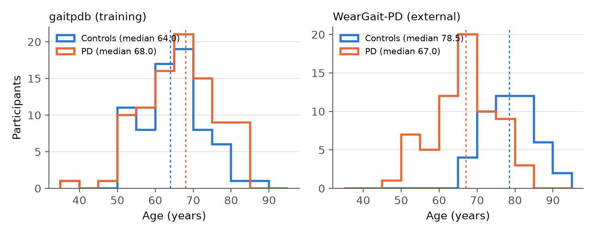
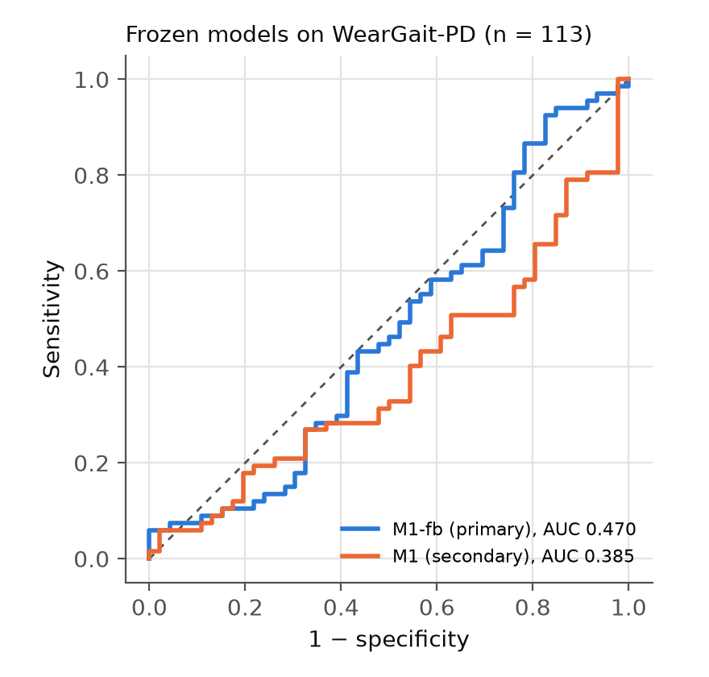
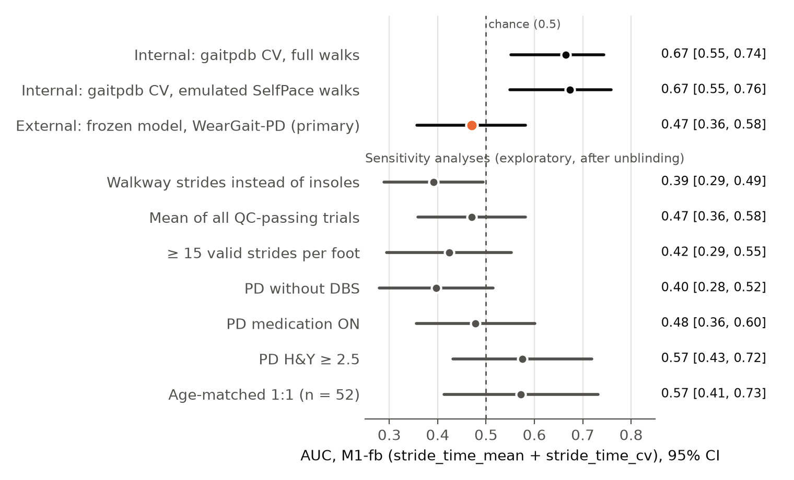

# External transportability of a plantar-pressure Parkinson's model: gaitpdb → WearGait-PD

**Results and discussion (draft, 2026-11-23).** Every number below comes from a logged run (see `PROJECT_LOG.md`).
Each result is labelled **confirmatory** (pre-registered, frozen before unblinding) or **exploratory**
(added after unblinding; never replaces the confirmatory result).

**Research question.** How well do gaitpdb-trained foot-pressure models transport to WearGait-PD, and which
components of the shift explain any loss?

**Answer in one paragraph.** The pre-registered primary model was the stride-time model M1-fb, trained on all
165 gaitpdb participants and frozen before anyone saw a WearGait-PD diagnosis. On 113 WearGait-PD
participants it did **not discriminate** Parkinson's disease from controls: AUC 0.470, 95% CI 0.357–0.582
(H1 not supported). This is well below its internal performance (0.67), including the internal
performance on walks cut to WearGait-PD's short SelfPace structure (0.673). The **residual cross-dataset
gap after matching walk structure** is 0.20 AUC (95% CI 0.03–0.34; H3 supported, Holm-adjusted). The null
result holds in every sensitivity analysis: other trials, walkway instead of insoles, stricter quality
rules, and patient subgroups. The clearest descriptive difference between the datasets is case-mix. WearGait-PD's
controls are 11.5 years older than its PD participants (median 78.5 vs 67), slower, and mostly female. In gaitpdb
the controls are slightly younger than the PD group. Age-matched estimates move towards 0.57 but stay
uncertain.

---

## 1. Methods in brief

| Element | Choice |
|---|---|
| Training data | gaitpdb (PhysioNet), the `_01` usual-walk recording of all 165 participants (93 PD, 72 controls; studies Ga, Ju, Si). Cued, dual-task and Ga `_02` walks excluded |
| External data | WearGait-PD v1 cross-sectional (Synapse syn55052683), SelfPace trial: four 16-ft walkway passes with Moticon insoles. Files were renamed to random codes and the diagnosis key kept apart until the freeze |
| Signal | Total vertical force per foot, the same contact detection for both datasets (100 Hz). Only strides fully inside a straight walking pass; 3-MAD outlier rule; gaps ≤ 20 ms interpolated (B-D3, B-D4) |
| Features (v2) | T1-core: stride time mean, stride time CV, swing time CV, stance %, swing asymmetry. **T1-fallback: stride time mean + CV** |
| Models | L2 logistic regression; imputation, scaling and C (inner CV, log loss) fitted inside training folds. Internal validation: 20 × 5-fold subject-level CV |
| Device check (R6) | Insole events against the ProtoKinetics walkway on 2,947 paired strides, with pre-declared tolerances |
| Primary external model | **M1-fb** (T1-fallback). It became primary because toe-off timing failed R6 (pre-declared rule D8 / B-D8). M1 (T1-core) is secondary |
| Walk-structure emulation | gaitpdb walks cut into 4 segments × 4–5 consecutive straight strides (20 draws), to estimate the internal AUC expected under WearGait-PD's walk structure (H3 reference). D15: train on full walks unless K-matched training gains ≥ 0.02 |
| Freeze | Git tag `model-frozen` with SHA-256 of the external table, training table, emulation summary and bootstrap draws (`research/protocol/FREEZE_RECORD.md`). Scored, fingerprinted, then unblinded |
| Confirmatory tests | **H1** external AUC > 0.5 (one-sided DeLong). **H2** speed-adjusted AAUC > 0.5 (Janes & Pepe; walkway speed; bootstrap B = 2,000). **H3** internal emulated AUC − external AUC > 0 (independent bootstrap combination). Holm over H1–H3, family α = 0.05; H2 interpreted only if H1 is rejected |

## 2. Cohorts

| Cohort | Group | n | Age, median (IQR) | Female % | Walking speed m/s, median (IQR) | H&Y median | Stride time CV, median |
|---|---|---|---|---|---|---|---|
| gaitpdb (training) | Controls | 72 | 64.0 (57–68) | 44 | 1.25 (1.13–1.35) | – | 2.29 |
| | PD | 93 | 68.0 (60–72) | 38 | 1.08 (0.91–1.18) | 2.0 | 2.57 |
| WearGait-PD (external, scored) | Controls | 46 | **78.5 (73–83)** | **70** | **0.95 (0.76–1.07)** | – | 3.88 |
| | PD | 67 | 67.0 (62–72) | 37 | 1.01 (0.87–1.18) | 2.0 | 3.69 |

- Of the 123 WearGait-PD participants, 10 had no insole data and were not scored (B-D1). They were **5 PD and 5 controls**, so the exclusion was balanced.
- All 113 trials with insoles passed QC (≥ 10 valid strides per foot; median 17).
- Speed is gaitpdb `Speed_01` (per-study methods) and WearGait-PD walkway footprint speed. They are comparable *within* a dataset only (A1.1 R2).
- H&Y is descriptive only.

*Figure 2. Age distributions by group. In gaitpdb the PD participants are slightly older than the controls. In WearGait-PD the controls are much older.*

## 3. Internal performance (gaitpdb)

| Model | Features | AUC (20 × 5 CV), mean ± SD | Bootstrap-of-CV 95% CI | Speed-adjusted AAUC [95% CI] |
|---|---|---|---|---|
| M1 | T1-core (5) | 0.824 ± 0.008 | 0.726–0.880 | 0.717 [0.611, 0.833] |
| **M1-fb** | stride time mean + CV | **0.665 ± 0.006** | 0.551–0.744 | 0.613 [0.511, 0.718] |
| M0 | speed only | 0.770 ± 0.004 | – | – |

- **Walk-structure emulation (E9), M1-fb:** 0.673 ± 0.022 over 20 draws, trained on full walks. The internal bootstrap-of-CV 95% range is 0.549–0.759.
- **D15:** K-matched training gained only +0.005, so the frozen model is trained on **full walks**.
- **K-curve (E8):** at K = 15 strides per foot, M1-fb reaches 0.646 and M1 0.789. Stride time CV loses reliability at short K (ICC 0.70), while stride time mean stays stable (ICC 0.98).
- So shortening the walk to WearGait-PD's structure **costs little internally**.

## 4. Device agreement (R6, label-free, before the freeze)

| Insole − walkway | Bias | SD (repeated-measures) | Tolerance | Result |
|---|---|---|---|---|
| Stride duration | +0.4 ms | 16.8 ms | bias ≤ 10 ms | **pass** |
| Stance duration | −35.3 ms | 39.6 ms | bias ≤ 20 ms | fail |
| Swing duration | +35.7 ms | 39.5 ms | SD ≤ 15 ms | fail |

- The insoles time **whole strides** correctly but detect toe-off differently from the walkway, and the difference varies by person.
- So stance, swing and asymmetry features are not trustworthy on WearGait-PD. Under the pre-declared rule, the heel-strike-only model **M1-fb became primary**.
- This also means the primary model's inputs are measured accurately: the external failure is **not** a stride-timing measurement error.

## 5. Confirmatory external results (frozen models, WearGait-PD, n = 113: 67 PD, 46 controls)

**Primary family: M1-fb, Holm-adjusted**

| Hypothesis | Estimate [95% CI] | One-sided p | Holm threshold | Decision |
|---|---|---|---|---|
| H1: AUC > 0.5 | **0.470** [0.357, 0.582] | 0.703 | 0.050 | not supported |
| H2: speed-adjusted AAUC > 0.5 | 0.553 [0.444, 0.665] | 0.171 | 0.025 | not supported (not interpretable, since H1 is not supported) |
| H3: gap (internal emulated − external) > 0 | **0.204** [0.034, 0.342] | 0.0065 | 0.0167 | **supported** |

- H2 precondition: the speed ranges overlap (PD 0.39–1.72 m/s, controls 0.48–1.46 m/s; 64 PD and all 46 controls inside the overlap).
- **Secondary, M1 (unadjusted):** AUC **0.385** [0.281, 0.490]. The ranking is reversed (PD participants score lower). AAUC 0.501; gap 0.408 [0.250, 0.521].
- **Calibration (secondary, separate from the primary result):**
  - M1-fb calibration intercept −1.20 and slope 0.006: it predicts PD for almost everyone (mean predicted risk 0.79), and its scores carry no ranking information.
  - In-sample logistic recalibration lowers the Brier score from 0.310 to 0.241, but only by predicting the base rate. Recalibration cannot create discrimination.

*Figure 3. ROC curves of the frozen models on WearGait-PD. Dashed line: chance.*

## 6. Sensitivity analyses (exploratory, after unblinding)

All of these use the frozen model, refitted with the frozen code and checked against the frozen coefficients. They test whether the null result depends on one analysis choice.

| Variation | n (PD/Co) | M1-fb AUC [95% CI] |
|---|---|---|
| Reference: frozen primary | 113 (67/46) | 0.470 [0.357, 0.582] |
| **Model trained inside WearGait-PD** (20 × 5 CV, same features) | 113 | **0.449** (repeat range 0.411–0.472) |
| Walkway-derived strides instead of insoles (all 123) | 123 (72/51) | 0.391 [0.289, 0.494] |
| Mean features over all QC-passing trials (1–3 per person) | 113 | 0.470 [0.359, 0.582] |
| Second trial (SelfPace_mat) / third trial (SelfPace_matTURN) | 29 / 45 | 0.574 [0.34, 0.81] / 0.425 [0.25, 0.60] |
| ≥ 15 valid strides per foot | 81 (48/33) | 0.424 [0.294, 0.553] |
| 4 passes and below-median missing data | 55 (39/16) | 0.351 [0.177, 0.525] |
| PD without DBS | 92 (46/46) | 0.397 [0.279, 0.515] |
| PD medication ON / OFF | 89 / 58 | 0.478 [0.356, 0.601] / 0.495 [0.309, 0.680] |
| PD H&Y ≥ 2.5 | 68 (22/46) | 0.575 [0.432, 0.719] |
| No assistive device | 107 (63/44) | 0.461 [0.345, 0.577] |
| **Age-matched 1:1** (caliper 3 years; median age 74 in both groups) | 52 (26/26) | **0.572** [0.413, 0.732] |
| Age-adjusted AAUC (control score ~ age) | 113 | 0.666 [0.441, 0.818] |

*Figure 1. Internal, emulated and external AUC of M1-fb, with the sensitivity analyses. Internal full-walk CI = participant-level bootstrap-of-CV; emulated CI = internal bootstrap-of-CV (B = 2,000).*

**What the sensitivity analyses show**
1. **The null result is not an artefact.** No choice of trial, device, stride count, quality rule, medication state or DBS status gives clear discrimination on straight walking.
2. **The stride-time features carry no PD information in WearGait-PD at all.** A model trained *on WearGait-PD itself* reaches 0.449, and its fitted coefficients are ≈ 0.
   - Univariate AUCs (PD high) on WearGait-PD: stride CV 0.47, swing CV 0.40, stance % 0.28. In gaitpdb: 0.68, 0.77 and 0.72.
3. **The device is not the cause.** The walkway, an independent measurement system, gives the same answer as the insoles (0.39).
4. **Age is the leading candidate explanation.**
   - The frozen M1-fb score rises with age among WearGait-PD controls (Spearman ρ = 0.29), and the controls are 11.5 years older than the PD participants.
   - Matching or adjusting for age moves the estimate towards 0.57–0.67, but every confidence interval still includes 0.5.
5. **A hint for future work.** In the two trials where participants stand and turn on the walkway, walkway-derived stride variability separates the groups better (AUC 0.61–0.66). Those "strides" include turning steps, so this measures turning, not straight walking. It is a hypothesis, not a result.

## 7. Interpretation

- **Fixed wording (protocol R1):** a residual cross-dataset gap remains after matching walk structure (0.20 AUC). This analysis cannot attribute the gap to any single source.
- What the evidence does and does not support:
  - **Walk length and segmentation** explain little of the loss: the emulated internal AUC was 0.673.
  - **Measurement of stride timing** is unlikely to explain it: the insoles agree with the walkway on stride duration (bias 0.4 ms), and walkway-based features fail too.
  - **Case-mix** differs strongly.
    - In gaitpdb, PD participants are slightly older and slower than controls (speed alone gives AUC 0.77 internally), and the model's markers partly track that.
    - In WearGait-PD the relationship is reversed: the controls are much older (median 78.5 vs 67), slower and more variable, and the PD participants are mostly mild (H&Y median 2), on medication and walking normally.
    - Stride variability therefore points the "wrong way", and a model built on it fails. This is consistent with, but does not prove, a case-mix explanation: the age-matched subset is small (n = 52).
- **Practical meaning:**
  - Simple stride-timing markers learned from one plantar-pressure cohort do not identify mild, treated Parkinson's disease in an independent cohort with a different age structure.
  - An internal AUC of 0.67–0.82 does not guarantee external performance.
  - The study shows why a frozen, pre-registered external test is necessary. Without it, an analyst could have chosen among the exploratory variants above.

## 8. Limitations

1. **Sample size.** n = 113 externally. The 95% CI for AUC is about ±0.11, and the subgroup and age-matched analyses are small.
2. **Age confounding is descriptive.** The age-matched and age-adjusted analyses were added after unblinding and their CIs include 0.5. Age, sex and speed are entangled in WearGait-PD's control group.
3. **The device check limited the primary model to two features.** The richer T1-core model (internal 0.824) relies on toe-off events that failed agreement. It did worse externally (0.385, reversed).
4. **Speed measures differ between datasets** (stopwatch versus walkway), so speed was used only within a dataset (H2), never across.
5. **The emulation reproduces walk structure, not context.** It does not reproduce gait initiation, walking on a mat, wearing 13 IMUs, footwear or instructions.
6. **Feet are sampled independently in the emulation**, and the emulation used fixed C = 1.0 while the frozen model tuned C. Both are documented deviations; neither changes the emulated AUC materially.
7. **Process.** The pre-freeze fixes (PR #13) were merged by the Lead before the teammate's review because of the sprint deadline. The review was requested and any finding will be logged as a deviation.

## 9. Reproducibility

- Code: tag `model-frozen` (commit `3cfa8ac`). The analysis scripts after the tag are `d_01_sensitivity.py` and `d_02_writeup_figures.py`.
- Input fingerprints are in `research/protocol/FREEZE_RECORD.md`. Score fingerprints were logged before unblinding (`external_scores.csv` `c698cde0…`); the confirmatory results are in `results.json` `800e5bc8…`.
- Data are not redistributed: gaitpdb from PhysioNet; WearGait-PD from Synapse under its data use terms. All figures and tables here are group-level summaries.
